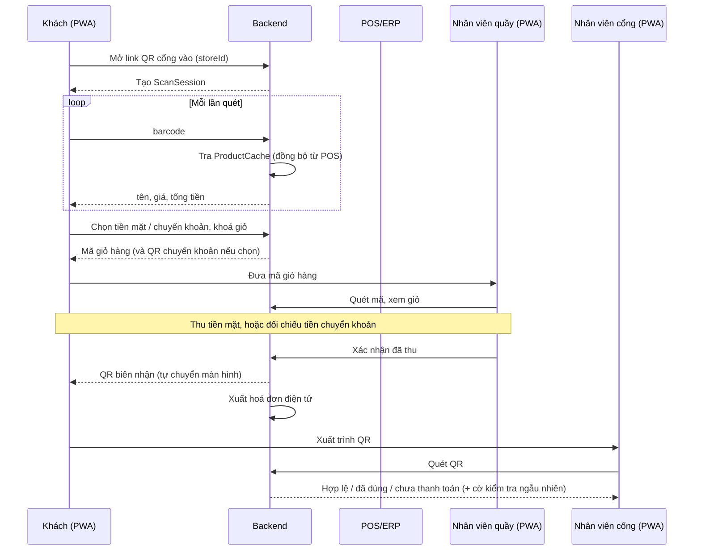

# 02. Yêu cầu chức năng

**Trạng thái:** Nháp. Cột "Tiêu chí chấp nhận" là khung, cần bổ sung cùng QA. Màn hình tương ứng xem [10](10-man-hinh.md).

Ưu tiên: **M** = bắt buộc giai đoạn 1, **S** = nên có, **C** = có thể hoãn, **GĐ2** = giai đoạn sau.

## 1. Khách hàng (PWA khách)

| Mã | User story | Ưu tiên | Màn hình | Tiêu chí chấp nhận (TODO) |
|----|-----------|---------|----------|---------------------------|
| FR-CUS-01 | Quét QR ở cổng vào để tự nhận diện chi nhánh | M | M01, M05 | Mở link → xác định `storeId`; chi nhánh chưa bật thì báo rõ |
| FR-CUS-02 | Quét mã vạch bằng camera để thêm vào giỏ ảo | M | M03, M04, M08, M09 | < 1 s (NFR-01); có hướng dẫn xin quyền camera |
| FR-CUS-03 | Thấy tên, giá, số lượng, tổng tiền cập nhật sau mỗi lần quét | M | M09, M12 | Cập nhật ngay; hiển thị khuyến mãi nếu có (G-03) |
| FR-CUS-04 | Sửa số lượng / xoá sản phẩm trước khi thanh toán | M | M12, M13 | |
| FR-CUS-05 | Cảnh báo khi mã không hợp lệ / không có trong hệ thống; nhập mã tay | M | M10, M11 | Phân biệt "không đọc được" và "không có trong hệ thống" |
| FR-CUS-06 | Chọn cách thanh toán: tiền mặt hoặc chuyển khoản QR | M | M16, M17, M18 | Cách trả tắt bởi cấu hình thì không chọn được; nhóm online hiện mờ |
| FR-CUS-07 | Nhận mã QR biên nhận duy nhất sau khi nhân viên xác nhận đã thu tiền | M | M19 | QR dùng một lần, hiển thị cả khi mất mạng (PWA-06) |
| FR-CUS-08 | Nhận hoá đơn điện tử; yêu cầu hoá đơn công ty bằng mã số thuế | M | M21, M22 | Hoá đơn bán lẻ mặc định; hoá đơn công ty trong ngày phát sinh (G-06) |
| FR-CUS-09 | Mất mạng tạm thời hoặc tải lại trang không mất giỏ hàng | M | M07, M14 | Lưu cục bộ, đồng bộ khi có mạng (PWA-03) |
| FR-CUS-10 | Được báo khi giá hoặc tồn kho thay đổi trước khi thanh toán và phải đồng ý | M | M15 | Hiện khi dữ liệu POS khác lúc quét (G-03) |
| FR-CUS-11 | Được hướng dẫn khi camera bị chặn hoặc link mở trong app khác (Zalo, Facebook) | M | M04, M06 | R6 |
| FR-CUS-12 | Được hướng dẫn nhanh lần đầu sử dụng | S | M02 | Bỏ qua được |
| FR-CUS-13 | Đánh giá trải nghiệm sau khi qua cổng | C | M21 | Một chạm, bỏ qua được |
| FR-CUS-14 | Xem lại lịch sử mua sắm và chi tiết từng đơn, kèm hoá đơn điện tử | S | M25, M26 | Khách không đăng nhập: lưu trên máy; xem trên máy khác bằng email có mã xác nhận (G-04) |

## 2. Thu tiền tại quầy (giai đoạn 1)

| Mã | User story | Ưu tiên | Màn hình | Ghi chú |
|----|-----------|---------|----------|---------|
| FR-PAY-01 | Khách bấm tiếp tục thì giỏ hàng bị khoá và hiện mã giỏ hàng để đưa nhân viên | M | M18 | Khách đổi cách trả thì mở khoá |
| FR-PAY-02 | Với chuyển khoản, app tự tạo QR có sẵn số tiền và nội dung là mã giao dịch | M | M17 | ADR-0002 |
| FR-PAY-03 | Nhân viên quét mã giỏ hàng (hoặc nhập tay) và thấy toàn bộ giỏ | M | N03, N04 | |
| FR-PAY-04 | Nhân viên thu tiền mặt, máy tính tiền thừa | M | N05 | |
| FR-PAY-05 | Nhân viên xác nhận chuyển khoản chỉ khi tick đủ: số tiền đúng, nội dung đúng mã, tiền đã vào tài khoản | M | N06 | Không xác nhận theo ảnh chụp màn hình của khách |
| FR-PAY-06 | Hệ thống ghi người thu, cách thu, thời điểm; màn khách tự chuyển sang QR biên nhận | M | N07, M19 | Audit (NFR-07) |
| FR-PAY-07 | Nhân viên kết thúc ca bằng đối soát tiền mặt thực tế với hệ thống; lệch phải ghi lý do | M | N14, A10 | |
| FR-PAY-08 | Quản trị chuỗi bật/tắt từng cách thanh toán theo chi nhánh | M | A02 | Cờ tính năng |
| FR-PAY-09 | Thanh toán online qua cổng (ví, VNPay, thẻ), tự xác nhận | GĐ2 | M23, M24 | Hiện mờ ở GĐ1 |
| FR-PAY-10 | Chi nhánh chọn thu tiền **qua POS**: khách chỉ có "Thanh toán tại quầy", thu ngân quét mã giỏ trong POS, POS thu tiền và xuất hoá đơn, BRG tự xác nhận khi POS báo thanh toán | M | M16, M18, A02 | [api-pos](api-pos.md) |
| FR-PAY-11 | API cho POS gọi: xem trước và nhận giỏ, hỏi trạng thái, báo đã thanh toán, báo huỷ; xác thực bằng khoá API quản lý được (tạo, thu hồi, giới hạn chi nhánh); idempotent theo mã đơn POS | M | A03 | |
| FR-PAY-12 | Quản trị theo dõi đơn POS (đã nhận, đã thanh toán, đã huỷ, lệch tiền, chờ lâu) và **nhả giỏ** khi POS không báo kết quả | M | Đơn POS, A07 | |
| FR-PAY-13 | Khách nhập thông tin hoá đơn (email, hoá đơn công ty) trước khi khoá giỏ để POS xuất đúng ngay lần đầu | M | M16 | |

## 3. Nhân viên cổng ra

| Mã | User story | Ưu tiên | Màn hình | Tiêu chí chấp nhận (TODO) |
|----|-----------|---------|----------|---------------------------|
| FR-GATE-01 | Quét QR biên nhận để xác nhận đã thanh toán hợp lệ | M | N08, N09 | |
| FR-GATE-02 | Báo ngay khi QR không hợp lệ / đã dùng / chưa thanh toán | M | N11 | Ba trạng thái hiển thị phân biệt; mọi lần từ chối được ghi log |
| FR-GATE-03 | Kiểm tra ngẫu nhiên đối chiếu giỏ thật – giỏ ảo theo tỷ lệ cấu hình | M | N10, N12, M20 | Máy chủ bốc theo tỷ lệ khi khoá giỏ, nhân viên không tự chọn; làm ở cổng ra, hoặc đối chiếu sớm tại quầy; không có nút bỏ qua |
| FR-GATE-04 | Quy trình xử lý khi chênh lệch (thu bổ sung / báo quản lý) | M | N13 | |
| FR-GATE-05 | Ghi log mọi lượt kiểm tra | M | N12, N13 | `ExitCheck` |
| FR-GATE-06 | Khách từ chối kiểm tra thì gọi quản lý | M | N10 | |
| FR-GATE-07 | Chi nhánh **không có bảo vệ** tắt được bước kiểm tra ở cổng: không bốc kiểm tra ngẫu nhiên, không có QR ra cổng, thanh toán xong khách ra luôn; tắt thì khách đã thanh toán mà chưa ra coi như đã ra | M | A02, M21 | Cờ `guardCheck` theo chi nhánh |

## 4. Quản trị

| Mã | User story | Vai trò | Ưu tiên | Màn hình |
|----|-----------|---------|---------|----------|
| FR-ADM-01 | Bật/tắt Self Checkout từng chi nhánh, không ảnh hưởng chi nhánh khác | Chuỗi | M | A02 |
| FR-ADM-02 | Báo cáo tổng hợp: giao dịch, doanh thu, tỷ lệ chênh lệch theo chi nhánh | Chuỗi | M | A01, A04 |
| FR-ADM-03 | Cấu hình & giám sát tích hợp (POS, chuyển khoản QR, hoá đơn) | Chuỗi | M | A03 |
| FR-ADM-04 | Báo cáo giao dịch, doanh thu riêng chi nhánh | Chi nhánh | M | A06 |
| FR-ADM-05 | Quản lý danh sách & ca làm việc nhân viên | Chi nhánh | M | A08, N01, N02 |
| FR-ADM-06 | Cấu hình tỷ lệ kiểm tra ngẫu nhiên | Chi nhánh | M | A09 |
| FR-ADM-07 | Phân quyền tài khoản và vai trò | Chuỗi | M | A05 |
| FR-ADM-08 | Đối soát tiền mặt theo ca và chuyển khoản với sao kê | Chi nhánh | M | A10 |
| FR-ADM-09 | Truy vết một giao dịch từ quét đến ra cổng | Chi nhánh | M | A07 |
| FR-ADM-10 | Xem mã vạch khách quét nhưng không có trong POS | Chi nhánh | S | A11 |
| FR-ADM-11 | Chọn cách tạo QR chuyển khoản: app tự tạo hoặc lấy từ nhà cung cấp | Chuỗi | M | A03 |
| FR-ADM-12 | Đăng nhập quản trị bằng tài khoản và mật khẩu, kèm mã xác thực 2 bước (đề xuất); khoá tạm khi sai nhiều lần; ghi log đăng nhập | Chuỗi, Chi nhánh | M | A12 |

## 5. Luồng chính giai đoạn 1

Khi bật thanh toán online (GĐ2), bước "Q → B xác nhận" được thay bằng thông báo từ cổng thanh toán và khách không phải đến quầy.

## 6. Trạng thái (khung)

- `ScanSession`: `active` → `locked` (đã khoá giỏ, chờ thu) → `paid` → `exited`; nhánh: `abandoned`, `expired`.
- `Transaction`: `awaiting_counter` → `paid` | `cancelled`; QR biên nhận: `issued` → `used` | `expired`. GĐ2 thêm `pending_online`, `failed`, `refunded`.
