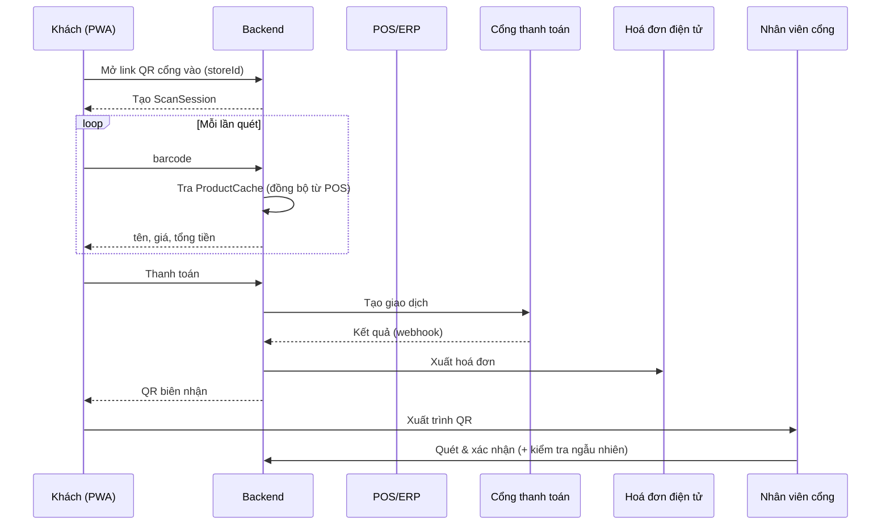

# 02. Yêu cầu chức năng

**Trạng thái:** Nháp. Cột "Tiêu chí chấp nhận" là khung, cần bổ sung cùng QA.

Ưu tiên: **M** = bắt buộc giai đoạn 1, **S** = nên có, **C** = có thể hoãn.

## 1. Khách hàng (PWA)

| Mã | User story | Ưu tiên | Tiêu chí chấp nhận (TODO) |
|----|-----------|---------|---------------------------|
| FR-CUS-01 | Quét QR ở cổng vào để tự nhận diện chi nhánh | M | Mở link → xác định `storeId`; chi nhánh chưa bật Scan & Go thì báo rõ |
| FR-CUS-02 | Quét mã vạch bằng camera để thêm vào giỏ ảo | M | < 1 s (NFR-01); xin quyền camera có hướng dẫn |
| FR-CUS-03 | Thấy tên, giá, số lượng, tổng tiền cập nhật sau mỗi lần quét | M | Cập nhật ngay; hiển thị khuyến mãi nếu có (xem G-03) |
| FR-CUS-04 | Sửa số lượng / xoá sản phẩm trước khi thanh toán | M | |
| FR-CUS-05 | Cảnh báo khi mã không hợp lệ / sản phẩm không có | M | Thông báo phân biệt "không đọc được" và "không có trong hệ thống" |
| FR-CUS-06 | Thanh toán trên điện thoại bằng ví/thẻ | M | Qua cổng thanh toán, không lưu thẻ (NFR-04) |
| FR-CUS-07 | Nhận mã QR biên nhận duy nhất sau thanh toán | M | QR dùng một lần, hiển thị được cả khi mất mạng sau thanh toán (PWA-06) |
| FR-CUS-08 | Nhận hoá đơn điện tử qua email / trong app | M | Cần thông tin người mua nếu xuất theo tên/MST (G-06) |
| FR-CUS-09 | Mất mạng tạm thời không mất giỏ hàng | M | Lưu cục bộ, đồng bộ khi có lại mạng (PWA-03) |

TODO bổ sung từ phân tích ([09](09-phan-tich-khoang-trong.md)): sản phẩm cân theo ký, hàng giới hạn độ tuổi, huỷ phiên, đóng/mở lại phiên, lịch sử đơn của khách.

## 2. Nhân viên cổng ra (PWA nhân viên)

| Mã | User story | Ưu tiên | Tiêu chí chấp nhận (TODO) |
|----|-----------|---------|---------------------------|
| FR-GATE-01 | Quét QR biên nhận để xác nhận đã thanh toán hợp lệ | M | |
| FR-GATE-02 | Báo ngay khi QR không hợp lệ / đã dùng / chưa thanh toán | M | 3 trạng thái hiển thị phân biệt |
| FR-GATE-03 | Kiểm tra ngẫu nhiên đối chiếu giỏ thật – giỏ ảo theo tỷ lệ cấu hình | M | Hệ thống tự "bốc" giao dịch cần kiểm tra theo tỷ lệ |
| FR-GATE-04 | Quy trình xử lý khi chênh lệch (thu bổ sung / báo quản lý) | M | Có trạng thái và kết quả cho từng ca chênh lệch |
| FR-GATE-05 | Ghi log mọi lượt kiểm tra | M | Ghi người thực hiện, thời điểm, kết quả (06: `ExitCheck`) |

## 3. Quản trị

| Mã | User story | Vai trò | Ưu tiên |
|----|-----------|---------|---------|
| FR-ADM-01 | Bật/tắt Scan & Go từng chi nhánh, không ảnh hưởng chi nhánh khác | Chuỗi | M |
| FR-ADM-02 | Báo cáo tổng hợp: giao dịch, doanh thu, tỷ lệ phát hiện chênh lệch theo chi nhánh | Chuỗi | M |
| FR-ADM-03 | Cấu hình & giám sát tích hợp (POS, thanh toán, hoá đơn) | Chuỗi | M |
| FR-ADM-04 | Báo cáo giao dịch/doanh thu riêng chi nhánh | Chi nhánh | M |
| FR-ADM-05 | Quản lý danh sách & ca làm việc nhân viên cổng | Chi nhánh | M |
| FR-ADM-06 | Cấu hình tỷ lệ kiểm tra ngẫu nhiên | Chi nhánh | M |
| FR-ADM-07 | Phân quyền quản trị viên chi nhánh | Chuỗi | M |

## 4. Luồng chính (khung)

TODO: sơ đồ trạng thái `ScanSession` và `Transaction` (xem [06](06-mo-hinh-du-lieu.md)).
