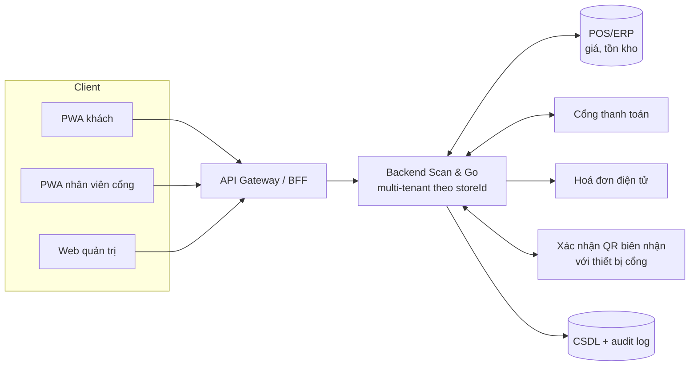

# 04. Kiến trúc hệ thống

**Trạng thái:** Nháp. Hình gốc: "backend trung tâm + 4 tích hợp" (ảnh trong tài liệu .docx).

## 1. Tổng quan

Một backend dùng chung, phân vùng theo `storeId`, ở giữa:

Bốn tích hợp: **POS/ERP**, **cổng thanh toán**, **hoá đơn điện tử**, **kiểm soát cổng ra**. Thiết bị cổng chính là PWA nhân viên.

## 2. Các khối (khung — TODO chọn công nghệ qua ADR)

| Khối | Trách nhiệm | Ghi chú |
|------|-------------|---------|
| API Gateway / BFF | Xác thực, giới hạn tốc độ, định tuyến `storeId` | |
| Dịch vụ phiên & giỏ | `ScanSession`, `CartItem` | Idempotent theo `clientEventId` để đồng bộ offline |
| Dịch vụ sản phẩm | Tra `ProductCache`, đồng bộ POS | Hai chế độ: real-time / định kỳ |
| Dịch vụ thanh toán | Tạo giao dịch, nhận webhook, đối soát | Không chạm dữ liệu thẻ |
| Dịch vụ hoá đơn | Xuất & lưu liên kết hoá đơn | Có hàng đợi, thử lại |
| Dịch vụ cổng ra | Sinh/xác nhận QR, bốc mẫu kiểm tra | |
| Quản trị & báo cáo | Cờ tính năng, báo cáo, phân quyền | |
| Audit | Ghi bất biến mọi sự kiện | Thời gian lưu: Q-06 |

## 3. Multi-tenant

- `storeId` có ở hầu hết thực thể; **mọi truy vấn lọc theo `storeId`** (ép ở tầng truy cập dữ liệu, không để từng API tự nhớ).
- Cờ tính năng theo chi nhánh: `scanAndGoEnabled` và các cờ con (TODO: danh sách cờ).
- Quản trị chuỗi có `storeId = null`.
- TODO: chọn mô hình tách dữ liệu (cột `storeId` dùng chung / schema riêng) → ADR.

## 4. Luồng dữ liệu then chốt

1. **Đồng bộ giá/tồn kho:** POS → `ProductCache` (xem [07](07-tich-hop-chong-that-thoat.md) mục 1).
2. **Quét:** client gửi `barcode` → backend trả sản phẩm + giá tại thời điểm quét → ghi `CartItem`.
3. **Thanh toán:** khoá giỏ → tạo giao dịch → webhook xác nhận → xuất hoá đơn → phát QR biên nhận.
4. **Cổng ra:** quét QR → xác nhận trạng thái → (ngẫu nhiên) kiểm tra → ghi `ExitCheck`.

## 5. Điểm lỗi & hành vi mong muốn (TODO điền)

| Sự cố | Hành vi |
|-------|---------|
| POS mất kết nối | Dùng `ProductCache`; cảnh báo nếu quá ngưỡng lệch (Q-12) |
| Webhook thanh toán chậm/mất | Trạng thái "đang chờ", truy vấn chủ động, không phát QR khi chưa chắc |
| Hoá đơn điện tử lỗi | Vẫn cho ra cổng (đã thanh toán); xuất bù qua hàng đợi |
| Khách mất mạng sau khi thanh toán | QR đã lưu cục bộ (PWA-06) |
| Thiết bị cổng mất mạng | TODO: chế độ xác nhận offline hay không (G-09) |

## 6. Triển khai & môi trường (TODO)

Môi trường dev/staging/prod, hạ tầng, HTTPS bắt buộc (camera chỉ chạy trên HTTPS), quản lý bí mật, CI/CD.
