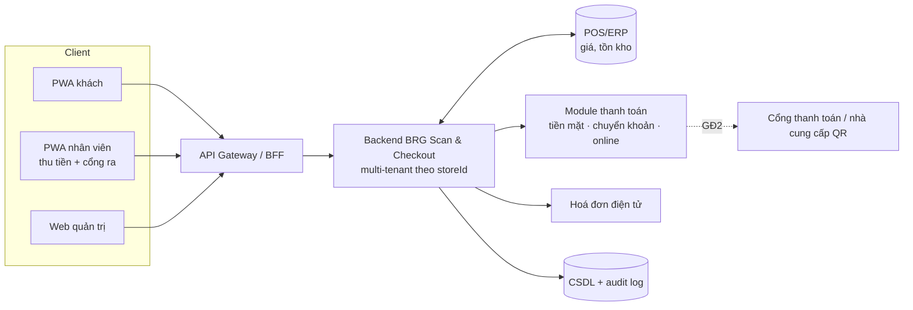

# 04. Kiến trúc hệ thống

**Trạng thái:** Nháp. Hình gốc trong tài liệu .docx: "backend trung tâm + 4 tích hợp". Đã điều chỉnh cho thanh toán thủ công ở giai đoạn 1.

## 1. Tổng quan

Một backend dùng chung, phân vùng theo `storeId`, ở giữa:

Tích hợp: **DSmart POS/ERP**, **hoá đơn điện tử**, và (GĐ2) **cổng thanh toán**. Ở GĐ1 không có tích hợp thanh toán bên ngoài: xác nhận thu tiền do nhân viên thực hiện qua PWA nhân viên. Thiết bị cổng ra cũng chính là PWA nhân viên.

## 2. Các khối (khung — TODO chọn công nghệ qua ADR)

| Khối | Trách nhiệm | Ghi chú |
|------|-------------|---------|
| API Gateway / BFF | Xác thực, giới hạn tốc độ, định tuyến `storeId` | |
| Dịch vụ phiên & giỏ | `ScanSession`, `CartItem`, khoá giỏ | Idempotent theo `clientEventId` để đồng bộ offline |
| Dịch vụ sản phẩm | Tra `ProductCache`, đồng bộ DSmart POS | Hai chế độ: real-time / định kỳ; kiểm tra lại giá khi khoá giỏ (FR-CUS-10) |
| **Module thanh toán** | Tạo giao dịch, chọn cách trả theo cờ chi nhánh, xác nhận thu | Xem mục 3 |
| Dịch vụ hoá đơn | Xuất & lưu liên kết hoá đơn | Có hàng đợi, thử lại |
| Dịch vụ cổng ra | Sinh/xác nhận QR biên nhận, bốc mẫu kiểm tra | |
| Quản trị & báo cáo | Cờ tính năng, báo cáo, phân quyền, đối soát | |
| Audit | Ghi bất biến mọi sự kiện | Thời gian lưu: Q-06 |

## 3. Module thanh toán (thay được cách trả và nguồn QR)

Mỗi chi nhánh có cấu hình `paymentMethods` (cờ bật/tắt từng cách) và `qrProvider`. Giao diện khách và luồng ra cổng không đổi khi thay các giá trị này.

| Cách trả | GĐ | Ai xác nhận đã trả | Trạng thái giao dịch |
|----------|----|--------------------|----------------------|
| Tiền mặt | 1 | Nhân viên (N05) | `awaiting_counter` → `paid` |
| Chuyển khoản QR, `qrProvider = self` | 1 | Nhân viên đối chiếu thông báo ngân hàng (N06) | `awaiting_counter` → `paid` |
| Chuyển khoản QR, `qrProvider = provider` | 2 | Nhà cung cấp gửi thông báo về backend | `pending_online` → `paid` |
| Ví, VNPay, thẻ | 2 | Cổng thanh toán gửi thông báo | `pending_online` → `paid` \| `failed` |

Giao diện nội bộ (khung): `QrProvider.createQr(transaction) → { qrPayload, expiresAt }`, với hai bản cài đặt `SelfQr` và `ProviderQr`. Xem [ADR-0002](adr/0002-qr-chuyen-khoan-thay-duoc.md).

Quy tắc chung cho cả hai cách tạo QR: nội dung chuyển khoản chứa **mã giao dịch duy nhất**; khớp khi **số tiền đúng, nội dung đúng mã, đúng tài khoản nhận**; thông báo trùng chỉ xử lý một lần (idempotent); thông báo từ nhà cung cấp phải có chữ ký.

## 4. Multi-tenant

- `storeId` có ở hầu hết thực thể; **mọi truy vấn lọc theo `storeId`** (ép ở tầng truy cập dữ liệu, không để từng API tự nhớ).
- Cờ tính năng theo chi nhánh: `scanAndGoEnabled` (tên mã nguồn tạm), `paymentMethods.cash`, `paymentMethods.qrTransfer`, `paymentMethods.online`, `randomCheckRate` (xem [06](06-mo-hinh-du-lieu.md) `StoreConfig`).
- Quản trị chuỗi có `storeId = null`.
- TODO: chọn mô hình tách dữ liệu (cột `storeId` dùng chung / schema riêng) → ADR.

## 5. Luồng dữ liệu then chốt

1. **Đồng bộ giá/tồn kho:** DSmart POS → `ProductCache` (xem [07](07-tich-hop-chong-that-thoat.md) mục 1).
2. **Quét:** client gửi `barcode` → backend trả sản phẩm + giá tại thời điểm quét → ghi `CartItem`.
3. **Khoá giỏ:** kiểm tra lại giá/tồn kho với dữ liệu DSmart POS; nếu khác thì báo khách đồng ý (M15); sinh mã giỏ hàng.
4. **Thu tiền (GĐ1):** nhân viên quét mã giỏ hàng → chọn cách thu → xác nhận → ghi `Payment` → phát QR biên nhận → xuất hoá đơn.
5. **Cổng ra:** quét QR → xác nhận trạng thái, đánh dấu đã dùng → (ngẫu nhiên) kiểm tra → ghi `ExitCheck`.

## 6. Điểm lỗi & hành vi mong muốn

| Sự cố | Hành vi |
|-------|---------|
| DSmart POS mất kết nối | Dùng `ProductCache`; cảnh báo nếu quá ngưỡng lệch (Q-12); banner ở A01 |
| Giá/tồn kho đổi giữa lúc quét và lúc khoá giỏ | Hiện M15, khách đồng ý rồi mới tiếp tục |
| Khách chuyển khoản sai số tiền hoặc sai nội dung | Nhân viên không tick đủ ba ô, không xác nhận; xử lý tại quầy |
| Nhân viên bấm nhầm xác nhận | TODO: quy trình huỷ có quyền quản lý và để lại dấu vết |
| Hoá đơn điện tử lỗi | Vẫn cho ra cổng (đã thu tiền); xuất bù qua hàng đợi |
| Khách mất mạng sau khi thu tiền | QR đã lưu cục bộ (PWA-06) |
| Thiết bị quầy/cổng mất mạng | Đề xuất GĐ1: cần mạng (xem D-05, G-09) |
| GĐ2: thông báo thanh toán chậm hoặc mất | Trạng thái "đang chờ", truy vấn chủ động, không phát QR khi chưa chắc |

## 7. Triển khai & môi trường (TODO)

Môi trường dev/staging/prod, hạ tầng, HTTPS bắt buộc (camera chỉ chạy trên HTTPS), quản lý bí mật, CI/CD.
