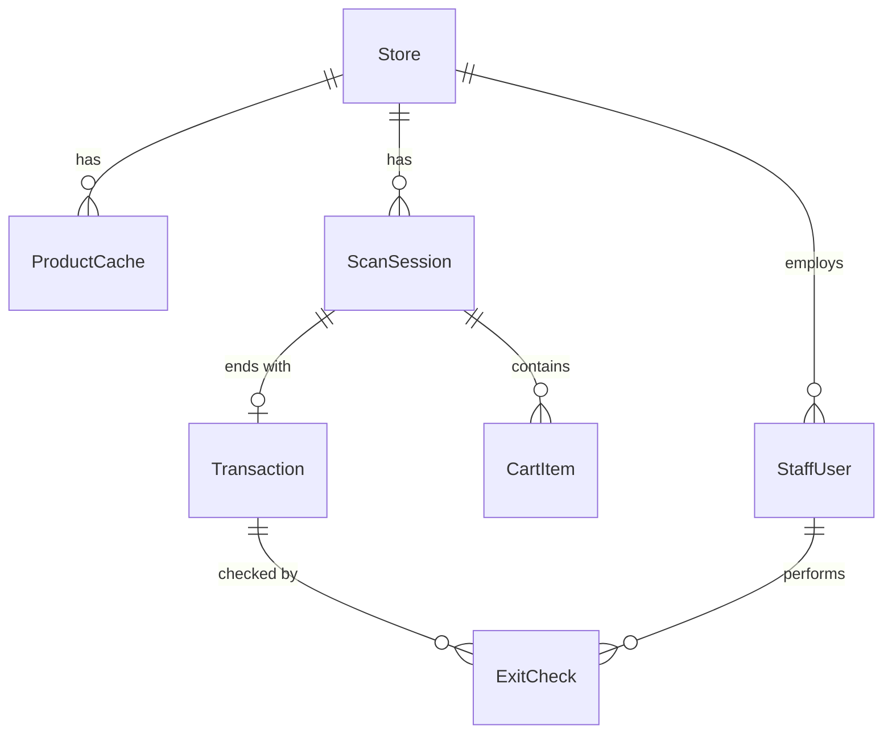

# 06. Mô hình dữ liệu

**Trạng thái:** Nháp. `storeId` là khoá phân vùng xuyên suốt; mọi truy vấn lọc theo chi nhánh.

## 1. Thực thể chính (theo tài liệu gốc)

| Thực thể | Mô tả | Trường chính | Quan hệ |
|----------|-------|--------------|---------|
| Store | Siêu thị trong chuỗi | `storeId`, tên, địa chỉ, `scanAndGoEnabled` | Gốc phân vùng |
| ProductCache | Bản sao giá/tồn kho từ POS | `sku`, `barcode`, `storeId`, tên, giá, tồn kho, `lastSyncedAt` | Thuộc 1 Store; nguồn gốc là POS |
| ScanSession | Một lượt mua sắm | `sessionId`, `storeId`, `startedAt`, `endedAt`, trạng thái | Thuộc 1 Store; nhiều CartItem |
| CartItem | Sản phẩm được quét | `sessionId`, `barcode`, số lượng, giá tại thời điểm quét | Thuộc 1 ScanSession |
| Transaction/Receipt | Giao dịch thanh toán + QR biên nhận | `transactionId`, `sessionId`, `storeId`, tổng tiền, trạng thái thanh toán, mã QR, link hoá đơn | 1-1 ScanSession |
| ExitCheck | Log mỗi lượt kiểm tra tại cổng | `checkId`, `transactionId`, nhân viên, kết quả (khớp/chênh lệch), ghi chú | Thuộc 1 Transaction |
| StaffUser | Nhân viên cổng + quản trị | `userId`, `storeId` (null = quản trị chuỗi), vai trò, trạng thái | Thuộc 1 Store (trừ quản trị chuỗi) |

## 2. Thiếu so với yêu cầu (đề xuất bổ sung — TODO xác nhận)

| Thực thể đề xuất | Lý do |
|------------------|-------|
| StoreConfig | Lưu tỷ lệ kiểm tra ngẫu nhiên (FR-ADM-06), cờ tính năng, ngưỡng lệch đồng bộ — hiện chưa có chỗ chứa |
| Payment | Tách khỏi Transaction: nhiều lần thử, webhook, hoàn tiền, đối soát |
| Invoice | Trạng thái xuất hoá đơn, số hoá đơn, lỗi/thử lại (không chỉ một "link") |
| AuditEvent | NFR-07: nhật ký bất biến toàn hệ thống, không chỉ `ExitCheck` |
| ScanEvent | "Sản phẩm quét nhưng không mua" (mục tiêu G3) cần giữ sự kiện quét/xoá, không chỉ trạng thái cuối giỏ |
| Shift / Gate | FR-ADM-05: ca làm việc của nhân viên cổng và cổng ra |
| Customer (tuỳ chọn) | Nếu cần hoá đơn theo tên/MST hoặc lịch sử đơn (G-06) |
| Promotion | Giá khuyến mãi từ POS (G-03) |

## 3. Trạng thái (khung — TODO hoàn thiện)

- `ScanSession`: `active` → `checkout` → `paid` → `exited`; nhánh: `abandoned`, `expired`.
- `Transaction`: `pending` → `paid` | `failed` | `refunded`; QR: `issued` → `used` | `expired`.
- `ExitCheck.kết_quả`: `khớp` | `chênh_lệch` (+ trạng thái xử lý: `đã_thu_bổ_sung` | `báo_quản_lý`).

## 4. Quy tắc dữ liệu

1. Giá trong `CartItem` **chốt tại lúc quét**; đổi giá ở POS sau đó không thay đổi giỏ đã quét (TODO quy tắc khi thanh toán, G-03).
2. `ProductCache` không bao giờ là nơi nhập liệu; chỉ ghi qua đồng bộ POS.
3. Dữ liệu cá nhân (nếu có) tách riêng, có thời hạn lưu (Q-06, NFR-09).
4. Tiền tệ lưu bằng số nguyên theo đơn vị nhỏ nhất (VND không có phần lẻ), không dùng số thực.

## 5. Chỉ mục & phân vùng (TODO)

Chỉ mục `(storeId, barcode)` cho ProductCache; truy vấn báo cáo theo `(storeId, thời gian)`.

## 6. Sự kiện phục vụ phân tích (G3)

`session_started`, `item_scanned`, `item_removed`, `scan_failed`, `payment_started/succeeded/failed`, `exit_checked`. TODO: lược đồ sự kiện và quy tắc ẩn danh.
