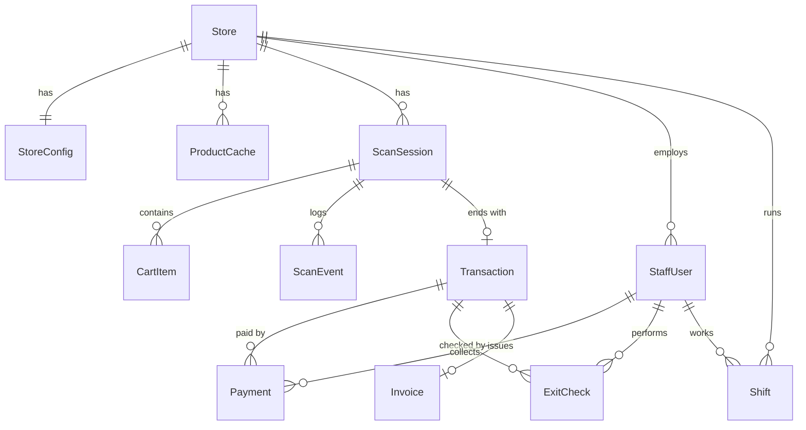

# 06. Mô hình dữ liệu

**Trạng thái:** Nháp. `storeId` là khoá phân vùng xuyên suốt; mọi truy vấn lọc theo chi nhánh.

## 1. Thực thể chính

| Thực thể | Mô tả | Trường chính | Quan hệ |
|----------|-------|--------------|---------|
| Store | Siêu thị trong chuỗi | `storeId`, tên, địa chỉ, `enabled` | Gốc phân vùng |
| StoreConfig | Cấu hình từng chi nhánh | `paymentMethods` (cash, qrTransfer, online), `qrProvider` (self/provider), `randomCheckRate`, ngưỡng lệch POS, tài khoản nhận chuyển khoản | 1-1 Store |
| ProductCache | Bản sao giá/tồn kho từ POS | `sku`, `barcode`, `storeId`, tên, giá, tồn kho, `lastSyncedAt` | Thuộc 1 Store; nguồn gốc là POS |
| ScanSession | Một lượt mua sắm | `sessionId`, `storeId`, `startedAt`, `endedAt`, trạng thái, `lockedAt` | Thuộc 1 Store; nhiều CartItem |
| CartItem | Sản phẩm được quét | `sessionId`, `barcode`, số lượng, giá tại thời điểm quét | Thuộc 1 ScanSession |
| Transaction | Giao dịch | `transactionId`, `sessionId`, `storeId`, tổng tiền, trạng thái, `cartCode` (mã giỏ hàng), mã QR biên nhận, link hoá đơn | 1-1 ScanSession |
| Payment | Một lần thu tiền | `paymentId`, `transactionId`, `method` (cash/qr_transfer/online), `amount`, `cashReceived`, `change`, `collectedBy` (StaffUser), `collectedAt`, `provider`, `providerRef` | Thuộc 1 Transaction |
| ExitCheck | Log mỗi lượt kiểm tra tại cổng | `checkId`, `transactionId`, nhân viên, kết quả (khớp/chênh lệch), loại và số tiền chênh lệch, hướng xử lý, ghi chú | Thuộc 1 Transaction |
| Shift | Ca làm việc | `shiftId`, `storeId`, `userId`, loại ca, tiền mặt hệ thống, tiền mặt đếm thực tế, lý do lệch | Thuộc 1 Store, 1 StaffUser |
| Invoice | Hoá đơn điện tử | `invoiceId`, `transactionId`, loại (bán lẻ/công ty), MST, trạng thái, số hoá đơn | Thuộc 1 Transaction |
| StaffUser | Tài khoản nhân viên và quản trị | `userId`, `storeId` (null nếu là quản trị chuỗi), vai trò, trạng thái, PIN (băm) | Thuộc 1 Store (trừ quản trị chuỗi) |
| AuditEvent | Nhật ký bất biến | `eventId`, `storeId`, thời điểm, tác nhân, hành động, đối tượng, dữ liệu trước/sau | Tham chiếu mọi thực thể |
| ScanEvent | Sự kiện quét/xoá/lỗi | `sessionId`, loại sự kiện, `barcode`, thời điểm | Thuộc 1 ScanSession |

## 2. Còn mở (TODO xác nhận)

| Thực thể | Lý do |
|----------|-------|
| Promotion | Giá khuyến mãi từ POS (G-03); giỏ hàng M12 đang giả định có dòng khuyến mãi |
| Customer (tuỳ chọn) | Nếu cần lịch sử đơn hoặc tự điền hoá đơn (G-04, G-06) |
| Gate | Nếu có nhiều cổng ra mỗi chi nhánh và cần báo cáo theo cổng |

## 3. Trạng thái

- `ScanSession`: `active` → `locked` → `paid` → `exited`; nhánh: `abandoned`, `expired`. Quay lại M16 từ M18 thì `locked` → `active`.
- `Transaction`: `awaiting_counter` → `paid` | `cancelled`. GĐ2 thêm `pending_online`, `failed`, `refunded`.
- QR biên nhận: `issued` → `used` | `expired`. Đánh dấu `used` ngay lúc nhân viên cổng quét thành công.
- `ExitCheck.kết_quả`: `khớp` | `chênh_lệch` (+ xử lý: `đã_thu_bổ_sung` | `báo_quản_lý`).

## 4. Quy tắc dữ liệu

1. Giá trong `CartItem` **chốt tại lúc quét**; khi khoá giỏ, hệ thống kiểm tra lại với dữ liệu POS, nếu khác thì khách phải đồng ý (FR-CUS-10).
2. `ProductCache` không bao giờ là nơi nhập liệu; chỉ ghi qua đồng bộ POS.
3. `Payment` và `AuditEvent` chỉ thêm, không sửa, không xoá. Sửa sai bằng bản ghi bù/huỷ có người duyệt.
4. Dữ liệu cá nhân (nếu có) tách riêng, có thời hạn lưu (Q-06, NFR-09). Không lưu ảnh từ camera.
5. Tiền tệ lưu bằng số nguyên theo đơn vị nhỏ nhất (VND không có phần lẻ), không dùng số thực.
6. Mã giao dịch (nội dung chuyển khoản) và `cartCode` phải duy nhất trong phạm vi chi nhánh và đủ ngắn để nhập tay; không thể đoán ra mã của khách khác.

## 5. Chỉ mục & phân vùng (TODO)

Chỉ mục `(storeId, barcode)` cho ProductCache; `(storeId, cartCode)` cho Transaction; truy vấn báo cáo theo `(storeId, thời gian)`.

## 6. Sự kiện phục vụ phân tích (G3)

`session_started`, `item_scanned`, `item_removed`, `scan_failed`, `cart_locked`, `payment_collected`, `exit_checked`. GĐ2 thêm `payment_started/succeeded/failed`. TODO: lược đồ sự kiện và quy tắc ẩn danh.
