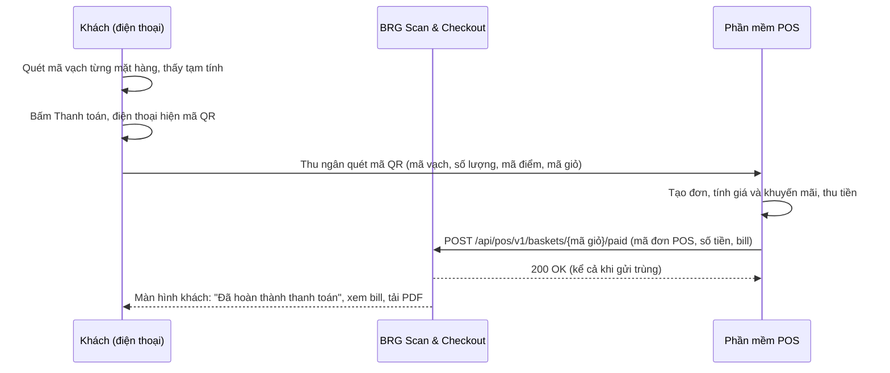

# Tài liệu tích hợp POS: mã QR giỏ hàng và báo thanh toán

Tài liệu này gửi cho đơn vị làm phần mềm POS. Có hai việc POS cần làm:

1. **Đọc mã QR** trên điện thoại khách để tạo đơn hàng và tính tiền (mục 2 và 3).
2. **Gọi API của BRG Scan & Checkout** để báo thanh toán thành công (mục 4 và 5). BRG Scan & Checkout trả lại kết quả cho khách và lưu bill.

## Hoá đơn điện tử: không có lúc thanh toán

**Lúc thanh toán chưa có hoá đơn điện tử và chưa có số hoá đơn.** POS thu tiền xong chỉ báo cho BRG Scan & Checkout: mã hàng, số lượng, thành tiền, tổng tiền và cách thanh toán. POS **không gửi số hoá đơn hay link hoá đơn**.

Hoá đơn điện tử được phát hành **sau đó**, khi khách tự khai báo thông tin xuất hoá đơn ở trang của nhà cung cấp hoá đơn. BRG Scan & Checkout chỉ hiện cho khách nút **Khai báo hoá đơn điện tử** mở link của nhà cung cấp (link do quản trị cấu hình, có thể gắn mã giỏ hoặc mã đơn POS vào link). Nếu nhà cung cấp cho khách khai báo bằng mã bill, mã đó là **mã đơn POS** (`posOrderRef`), nên hãy dùng mã mà khách đọc được trên bill của POS.

## 1. Quy trình tổng thể



| Bước | Ai làm | Nội dung |
|------|--------|----------|
| 1 | Khách và BRG Scan & Checkout | Khách quét mặt hàng bằng điện thoại. Điện thoại hiện **tạm tính**, chỉ để tham khảo |
| 2 | BRG Scan & Checkout | Khi khách bấm Thanh toán, tạo **mã giỏ** và mã QR. Mã QR lưu trên điện thoại nên còn khi mất mạng |
| 3 | POS | Thu ngân quét mã QR. POS đọc, kiểm tra, **tạo đơn** với đúng mặt hàng và số lượng |
| 4 | POS | Tính giá và khuyến mãi **theo hệ thống của POS**, thu tiền (tiền mặt, QR, thẻ). Chưa có hoá đơn điện tử lúc này |
| 5 | POS | **Báo thanh toán về BRG Scan & Checkout** bằng API ở mục 4. Số tiền trong báo cáo này là số tiền thật |
| 6 | BRG Scan & Checkout | Ghi nhận, màn hình khách hiện hoàn thành, khách xem và tải bill |

**Hai mã định danh cần phân biệt**

| Tên | Do ai sinh | Có trong mã QR | Dùng để |
|-----|-----------|----------------|---------|
| **Mã giỏ** (ví dụ `Q7-LM3K2AB`) | BRG Scan & Checkout (điện thoại khách) | Có | BRG Scan & Checkout nhận ra giỏ. POS gửi lại trong đường dẫn khi báo thanh toán |
| **Mã đơn POS** (`posOrderRef`, mã giao dịch hoặc mã bill của POS) | POS | Không | POS gửi lại trong báo thanh toán. BRG Scan & Checkout dùng để **chống ghi trùng** và đối soát |

## Quy tắc then chốt: kiểm tra mã điểm

> **POS bắt buộc kiểm tra mã điểm trước mọi bước khác.** Mã điểm trong mã QR phải **đúng bằng mã điểm của cửa hàng mà máy POS đang bán**. Không khớp thì **từ chối ngay: không tạo đơn, không thu tiền**, báo thu ngân "Mã này của cửa hàng khác". Không có ngoại lệ.

Mã điểm đi từ đâu đến đâu:

1. Quản trị BRG Scan & Checkout nhập **mã điểm** cho từng chi nhánh (đúng mã của cửa hàng trong hệ thống giá và POS).
2. Khách quét mã QR dán ở cổng vào của cửa hàng. BRG Scan & Checkout biết khách ở chi nhánh nào và lấy mã điểm của chi nhánh đó.
3. Giá của từng mặt hàng được tra theo mã điểm này, và mã điểm được ghi vào mã QR giỏ hàng.
4. POS quét mã QR giỏ, **so mã điểm trong mã QR với mã điểm của mình**. Khác thì từ chối.
5. Khi POS báo thanh toán về BRG Scan & Checkout, POS phải gửi lại `pointCode` (mã điểm của mình). BRG Scan & Checkout so với mã điểm của giỏ; **khác thì từ chối** (lỗi `POINT_MISMATCH`), không ghi thanh toán.

Cửa hàng **chưa có mã điểm** thì không bật được và khách không tạo được mã QR giỏ.

## 2. Định dạng mã QR

Một chuỗi văn bản ASCII, các phần ngăn bằng ký tự `|`:

```
BRG1|<mã điểm>|<mã giỏ>|<giờ>|<mã vạch>*<số lượng>,<mã vạch>*<số lượng>,...|T<tạm tính>|<CRC16>
```

Ví dụ (có sẵn trong `docs/mau/qr-gio-hang-mau.txt` và ảnh `docs/mau/qr-gio-hang-mau.svg`):

```
BRG1|SP-0107|Q7-LM3K2AB|1793845800|8936036123456*2,8934567890123*1|T60800|1E1A
```

| Phần | Ý nghĩa |
|------|---------|
| `BRG1` | Nhận dạng và phiên bản. Chuỗi không bắt đầu bằng `BRG1|` thì không phải mã của BRG Scan & Checkout |
| mã điểm | Mã siêu thị trong hệ thống giá và POS, do quản trị BRG Scan & Checkout nhập cho từng chi nhánh. POS **nên so với điểm bán của máy đang dùng**, khác thì báo thu ngân |
| mã giỏ | Duy nhất. POS **lưu mã này** để không tạo đơn hai lần nếu mã bị quét lại |
| giờ | Giờ tạo giỏ, giây Unix |
| mặt hàng | `mã vạch*số lượng`, cách nhau dấu phẩy. Cùng mã vạch đã gộp thành một dòng. Mã vạch là mã **in trên tem** hàng hoá. Số lượng từ 1 đến 999 |
| `T` | **Tạm tính** của BRG Scan & Checkout (VND). Chỉ để đối chiếu, **không dùng làm số tiền thu** |
| CRC16 | CRC16-CCITT (đa thức `0x1021`, khởi tạo `0xFFFF`), 4 ký tự hex viết hoa, tính trên toàn bộ chuỗi đứng **trước dấu `|` cuối cùng** |

**Mã QR chứa được bao nhiêu mặt hàng?** Mỗi mặt hàng chiếm khoảng 16 ký tự. Giới hạn kỹ thuật của mã QR là khoảng 180 mặt hàng khác nhau, nhưng mã càng lớn càng khó quét từ màn hình điện thoại. Vì vậy ứng dụng giới hạn **tối đa 60 mặt hàng khác nhau mỗi giỏ** (đổi được bằng biến `MAX_CART_ITEMS` trong `.env` của máy chủ). Mỗi mặt hàng có số lượng từ 1 đến 99. Giỏ 60 mặt hàng cho mã QR dài khoảng 1.000 ký tự, cỡ 109 × 109 ô, máy quét 2D thông thường đọc tốt. Khách vượt mức được báo "Giỏ đã đầy", thanh toán giỏ này rồi quét giỏ mới cho phần còn lại.

Máy quét nên là loại đọc được mã 2D (không phải máy laser đọc vạch).

### Tính CRC16 (ví dụ)

```python
def crc16(s: str) -> str:
    crc = 0xFFFF
    for ch in s.encode("ascii"):
        crc ^= ch << 8
        for _ in range(8):
            crc = ((crc << 1) ^ 0x1021) & 0xFFFF if crc & 0x8000 else (crc << 1) & 0xFFFF
    return f"{crc:04X}"

text = "BRG1|SP-0107|Q7-LM3K2AB|1793845800|8936036123456*2,8934567890123*1|T60800|1E1A"
body, _, check = text.rpartition("|")
assert crc16(body) == check   # đúng thì mã chưa bị sửa hoặc đọc sai
```

```csharp
static string Crc16(string s) {
    ushort crc = 0xFFFF;
    foreach (byte b in System.Text.Encoding.ASCII.GetBytes(s)) {
        crc ^= (ushort)(b << 8);
        for (int i = 0; i < 8; i++) crc = (crc & 0x8000) != 0 ? (ushort)((crc << 1) ^ 0x1021) : (ushort)(crc << 1);
    }
    return crc.ToString("X4");
}
```

### POS xử lý khi quét

1. Kiểm tra tiền tố `BRG1|` và CRC16. Sai thì báo "Mã không hợp lệ, nhờ khách tạo lại".
2. **Kiểm tra mã điểm (bắt buộc):** phải bằng mã điểm của cửa hàng máy POS đang bán. Không khớp thì **từ chối, không tạo đơn, không thanh toán**, báo thu ngân "Mã này của cửa hàng khác".
3. Kiểm tra mã giỏ chưa dùng. Đã dùng thì mở lại đơn cũ, không tạo đơn mới.
4. Với mỗi dòng, tìm sản phẩm theo mã vạch (mã nhà cung cấp hoặc mã nội bộ đều được, tuỳ POS) và thêm đúng số lượng. Mã không có trong POS thì báo thu ngân xử lý tại chỗ.
5. POS tự tính giá, khuyến mãi, trừ kho. **BRG Scan & Checkout không quản lý tồn kho và không tính tiền thay POS.**

## 3. Thông tin BRG Scan & Checkout cung cấp cho POS để chạy được

| Thông tin | Cách có |
|-----------|---------|
| Địa chỉ API (ví dụ `https://scan.hcrc.vn`) | BRG Scan & Checkout cung cấp |
| Khoá API | Quản trị BRG Scan & Checkout tạo ở mục Tích hợp, có thể giới hạn theo chi nhánh. Chỉ hiện **một lần** |
| Mã điểm của từng chi nhánh | Quản trị BRG Scan & Checkout nhập, hai bên thống nhất với mã điểm trong POS |
| Môi trường thử và mã QR mẫu | BRG Scan & Checkout cấp môi trường thử, kèm mã QR mẫu ở `docs/mau/` |

## 4. API báo thanh toán thành công

Xác thực: header `Authorization: Bearer <khoá API>` (hoặc `X-Api-Key`). Chỉ gọi qua HTTPS. Nội dung JSON, UTF-8.

`POST /api/pos/v1/baskets/{mã giỏ}/paid`

```json
{
  "pointCode": "SP-0107",
  "posOrderRef": "POS-20261105-000123",
  "amount": 60800,
  "method": "qr_transfer",
  "cashier": "Lan",
  "terminal": "QUAY-02",
  "lines": [
    { "barcode": "8936036123456", "name": "Sữa tươi 1L", "qty": 2, "unitPrice": 29000, "discount": 0, "lineTotal": 58000 },
    { "barcode": "8934567890123", "name": "Mì ăn liền tôm", "qty": 1, "unitPrice": 4800, "discount": 2000, "lineTotal": 2800 }
  ]
}
```

| Trường | Bắt buộc | Ý nghĩa |
|--------|----------|---------|
| `pointCode` | **Có** | **Mã điểm của cửa hàng máy POS đang bán.** BRG Scan & Checkout so với mã điểm của giỏ, khác thì từ chối. |
| `posOrderRef` | **Có** | Mã đơn (mã giao dịch hoặc mã bill) trên POS. **Khoá chống trùng** |
| `amount` | **Có** | Số tiền thực thu, VND, số nguyên dương |
| `method` | **Có** | `cash`, `qr_transfer`, `card`, `ewallet` |
| `lines` | Nên có | Các dòng bill POS với giá và khuyến mãi thật. Có thì khách thấy đúng bill POS. Không có thì khách thấy bản tạm tính, ghi rõ "chưa có bill chính thức" |
| `cashier`, `terminal` | Không | Hiện trên bill và báo cáo |

Mỗi dòng của `lines`:
- **Bắt buộc:** `barcode` (mã hàng; hoặc `name` nếu không có mã), `qty` (số lượng), `lineTotal` (thành tiền của dòng, số nguyên đồng).
- **Không bắt buộc:** `name` (bỏ trống thì hệ thống tự điền theo mã hàng), `unitPrice` (bỏ trống thì hệ thống tính bằng (`lineTotal` + `discount`) chia `qty`), `discount` (số tiền giảm của dòng).

Vì vậy POS chỉ cần gửi **mã hàng, số lượng, thành tiền** từng dòng là đủ để khách thấy bill.

**Khuyến mãi hiện trên bill thế nào:**
- Gửi `lineTotal` là thành tiền **đã trừ khuyến mãi của mặt hàng**. Nếu chỉ gửi `lineTotal`, bill hiện đơn giá bình quân (`lineTotal` chia `qty`).
- Muốn bill hiện giá gốc và số tiền giảm của mặt hàng, gửi thêm `unitPrice` (giá gốc) và `discount` (số tiền giảm). Ví dụ giá gốc 30.000, giảm 5.000: `unitPrice` 30000, `discount` 5000, `lineTotal` 25000.
- Giảm giá cấp hoá đơn (voucher, làm tròn, khuyến mãi theo tổng tiền): **không cần gửi riêng**. Hệ thống lấy `amount` trừ tổng các dòng, nếu khác 0 thì hiện dòng "Điều chỉnh theo hoá đơn" để bill cộng đúng và khớp số tiền POS thu.
- Bill hiện đúng những gì POS gửi, kể cả khi thu ngân thêm hoặc bớt mặt hàng so với giỏ trên điện thoại khách.

**Phản hồi thành công `200`:**

```json
{ "ok": true, "duplicate": false, "transactionId": "SG-Q7-0042", "status": "paid", "amountMatches": true }
```

`duplicate: true` nghĩa là BRG Scan & Checkout đã nhận trước đó (không ghi lần hai). `amountMatches: false` nghĩa là số tiền POS thu khác tạm tính của BRG Scan & Checkout. Việc này **bình thường** (khuyến mãi khác), BRG Scan & Checkout vẫn lấy số của POS.

### Các lệnh khác

| Lệnh | Dùng để |
|------|---------|
| `GET /api/pos/v1/baskets/{mã giỏ}` | Xem trạng thái giỏ (đã thanh toán chưa, đã lưu bill chưa) |
| `POST /api/pos/v1/baskets/{mã giỏ}/cancelled` | POS huỷ đơn. Body: `{ "posOrderRef": "...", "reason": "..." }` |
| `GET /api/pos/v1/health` | Kiểm tra khoá API và kết nối |

### Lỗi

Dạng `{ "error": "MÃ", "message": "…" }`.

| HTTP | Mã lỗi | Ý nghĩa | POS làm |
|------|--------|---------|---------|
| 400 | `POINT_REQUIRED` | Thiếu `pointCode` | Gửi lại có `pointCode` |
| 409 | `POINT_MISMATCH` | **Mã điểm không khớp** cửa hàng của giỏ | **Không thử lại, không thanh toán**, báo quản lý |
| 400 | `BAD_AMOUNT`, `BAD_METHOD`, `BAD_LINES`, `REF_REQUIRED` | Dữ liệu gửi sai | Sửa rồi gửi lại (không tự thử lại) |
| 401 | `NO_API_KEY`, `BAD_API_KEY` | Khoá thiếu, sai hoặc bị thu hồi | Không thử lại, báo quản lý |
| 403 | `STORE_FORBIDDEN` | Khoá không dùng cho chi nhánh này | Không thử lại |
| 404 | `BASKET_NOT_FOUND` | Chưa thấy giỏ. Điện thoại khách có thể đang mất mạng nên giỏ chưa lên hệ thống | **Thử lại sau** |
| 409 | `REF_IN_USE` | Giỏ đã gắn với đơn POS khác hoặc mã đơn dùng cho giỏ khác | Không thử lại, báo quản lý |
| 409 | `ORDER_CANCELLED` | Đơn đã bị huỷ | Không thử lại, đối soát tay |
| 5xx, timeout, 429 | | Lỗi tạm thời | **Thử lại** |

## 5. Quy tắc thử lại (bắt buộc với POS)

Mạng có thể chập chờn, nên **POS phải thử lại cho đến khi BRG Scan & Checkout trả `200`**. BRG Scan & Checkout xử lý gửi trùng an toàn (cùng mã giỏ và cùng `posOrderRef`), nên thử lại không thu tiền hai lần.

- **Lịch:** lần 1 ngay sau khi thu tiền; thử lại sau 5 giây, 30 giây, 2 phút (tổng 4 lần).
- **Sau 4 lần vẫn chưa được:** POS giữ đơn trong hàng đợi, thử lại **mỗi 5 phút**, tối đa 24 giờ, và báo quản lý cửa hàng.
- Mọi lần thử gửi **cùng nội dung**.
- Chỉ thử lại với lỗi ở cột "Thử lại" ở mục 4. Lỗi 400, 401, 403, 409 thì dừng và báo người quản lý.
- Khách vẫn hoàn tất được nếu POS báo chậm: khách bấm "Đã thanh toán xong", khi POS báo sau thì BRG Scan & Checkout cập nhật thành đã thanh toán kèm số tiền thật và bill.

Ví dụ gọi thử:

```bash
curl -X POST "https://scan.hcrc.vn/api/pos/v1/baskets/Q7-LM3K2AB/paid" \
  -H "Authorization: Bearer brgpos_xxxxxxxx" -H "Content-Type: application/json" \
  -d '{"posOrderRef":"POS-1","pointCode":"SP-0107","amount":60800,"method":"cash"}'
```

## 6. Bill khách xem

- Khách xem bill ngay trong ứng dụng web và tải bản **PDF**. Bill lưu trên điện thoại để xem lại khi mất mạng; tải PDF cần mạng.
- Nội dung bill lấy từ `lines` và `amount` POS gửi, kèm mã đơn POS. Không in giấy.
- Bill có nút **Khai báo hoá đơn điện tử** (link nhà cung cấp do quản trị cấu hình).

## 7. Danh sách kiểm tra khi tích hợp

- [ ] POS quét được mã QR mẫu `docs/mau/qr-gio-hang-mau.svg` và đọc ra đúng 2 dòng hàng, mã điểm `SP-0107`, mã giỏ `Q7-LM3K2AB`.
- [ ] POS kiểm tra CRC16 và từ chối khi chuỗi bị sửa một ký tự.
- [ ] Quét cùng một mã QR hai lần không tạo hai đơn.
- [ ] **Mã điểm trong mã QR khác mã điểm cửa hàng của POS thì POS từ chối ngay**, không tạo đơn, không thu tiền.
- [ ] Báo thanh toán thiếu `pointCode` bị từ chối (400), sai `pointCode` bị từ chối (409 `POINT_MISMATCH`).
- [ ] Báo thanh toán lần 1 trả `duplicate: false`, lần 2 trả `duplicate: true`, không thu hai lần.
- [ ] Ngắt mạng giữa chừng: POS thử lại theo lịch ở mục 5 và cuối cùng báo được.
- [ ] Số tiền POS tính khác tạm tính vẫn báo được bình thường.
- [ ] Khách thấy "Đã hoàn thành thanh toán" và bill khớp với bill POS.
