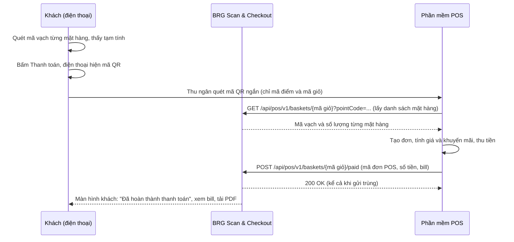

# Tài liệu tích hợp Dsmart POS: mã QR giỏ hàng và báo thanh toán

Tài liệu này gửi cho đơn vị làm phần mềm Dsmart POS. Có hai việc Dsmart POS cần làm:

1. **Đọc mã QR** trên điện thoại khách để tạo đơn hàng và tính tiền (mục 2 và 3).
2. **Gọi API của BRG Scan & Checkout** để báo thanh toán thành công (mục 4 và 5). BRG Scan & Checkout trả lại kết quả cho khách và lưu bill.

## Hoá đơn điện tử: không có lúc thanh toán

**Lúc thanh toán chưa có hoá đơn điện tử và chưa có số hoá đơn.** Dsmart POS thu tiền xong chỉ báo cho BRG Scan & Checkout: mã hàng, số lượng, thành tiền, tổng tiền và cách thanh toán. Dsmart POS **không gửi số hoá đơn hay link hoá đơn**.

Hoá đơn điện tử được phát hành **sau đó**, khi khách tự khai báo thông tin xuất hoá đơn ở trang của nhà cung cấp hoá đơn. BRG Scan & Checkout chỉ hiện cho khách nút **Khai báo hoá đơn điện tử** mở link của nhà cung cấp (link do quản trị cấu hình, có thể gắn mã giỏ hoặc mã đơn Dsmart POS vào link). Nếu nhà cung cấp cho khách khai báo bằng mã bill, mã đó là **mã đơn Dsmart POS** (`posOrderRef`), nên hãy dùng mã mà khách đọc được trên bill của Dsmart POS.

## 1. Quy trình tổng thể



| Bước | Ai làm | Nội dung |
|------|--------|----------|
| 1 | Khách và BRG Scan & Checkout | Khách quét mặt hàng bằng điện thoại. Điện thoại hiện **tạm tính**, chỉ để tham khảo |
| 2 | BRG Scan & Checkout | Khi khách bấm Thanh toán, điện thoại gửi giỏ lên máy chủ rồi hiện mã QR **ngắn**, chỉ chứa **mã điểm và mã giỏ** |
| 3 | Dsmart POS | Thu ngân quét mã QR. Dsmart POS đọc mã điểm, mã giỏ, kiểm tra mã điểm, rồi **gọi API lấy danh sách mặt hàng** (mã vạch, số lượng) và **tạo đơn** |
| 4 | Dsmart POS | Tính giá và khuyến mãi **theo hệ thống của Dsmart POS**, thu tiền (tiền mặt, QR, thẻ). Chưa có hoá đơn điện tử lúc này |
| 5 | Dsmart POS | **Báo thanh toán về BRG Scan & Checkout** bằng API ở mục 4. Số tiền trong báo cáo này là số tiền thật |
| 6 | BRG Scan & Checkout | Ghi nhận, màn hình khách hiện hoàn thành, khách xem và tải bill |

**Hai mã định danh cần phân biệt**

| Tên | Do ai sinh | Có trong mã QR | Dùng để |
|-----|-----------|----------------|---------|
| **Mã giỏ** (ví dụ `Q7-LM3K2AB`) | BRG Scan & Checkout (điện thoại khách) | Có | Dsmart POS dùng mã giỏ để lấy danh sách mặt hàng, và gửi lại trong đường dẫn khi báo thanh toán |
| **Mã đơn Dsmart POS** (`posOrderRef`, mã giao dịch hoặc mã bill của Dsmart POS) | Dsmart POS | Không | Dsmart POS gửi lại trong báo thanh toán. BRG Scan & Checkout dùng để **chống ghi trùng** và đối soát |

## Quy tắc then chốt: kiểm tra mã điểm

> **Dsmart POS bắt buộc kiểm tra mã điểm trước mọi bước khác.** Mã điểm trong mã QR phải **đúng bằng mã điểm của cửa hàng mà máy Dsmart POS đang bán**. Không khớp thì **từ chối ngay: không tạo đơn, không thu tiền**, báo thu ngân "Mã này của cửa hàng khác". Không có ngoại lệ.

Mã điểm đi từ đâu đến đâu:

1. Quản trị BRG Scan & Checkout nhập **mã điểm** cho từng chi nhánh (đúng mã của cửa hàng trong hệ thống giá và Dsmart POS).
2. Khách quét mã QR dán ở cổng vào của cửa hàng. BRG Scan & Checkout biết khách ở chi nhánh nào và lấy mã điểm của chi nhánh đó.
3. Giá của từng mặt hàng được tra theo mã điểm này, và mã điểm được ghi vào mã QR giỏ hàng.
4. Dsmart POS quét mã QR giỏ, **so mã điểm trong mã QR với mã điểm của mình**. Khác thì từ chối.
5. Khi gọi API lấy danh sách mặt hàng và khi báo thanh toán, Dsmart POS phải gửi `pointCode` (mã điểm của mình). Với lệnh lấy hàng, khác mã điểm thì BRG Scan & Checkout **không trả hàng** (lỗi `POINT_MISMATCH`). Với lệnh báo thanh toán, Dsmart POS phải gửi lại `pointCode` (mã điểm của mình). BRG Scan & Checkout so với mã điểm của giỏ; **khác thì từ chối** (lỗi `POINT_MISMATCH`), không ghi thanh toán.

Cửa hàng **chưa có mã điểm** thì không bật được và khách không tạo được mã QR giỏ.

## 2. Định dạng mã QR và lấy danh sách mặt hàng

Mã QR **chuẩn** rất ngắn, chỉ chứa mã điểm và mã giỏ. Danh sách mặt hàng (mã vạch, số lượng) **không nằm trong mã QR** mà Dsmart POS lấy bằng API ngay sau khi quét, nên mã QR luôn nhỏ, quét nhanh dù giỏ có nhiều mặt hàng.

Một chuỗi văn bản ASCII, các phần ngăn bằng ký tự `|`:

```
BRG2|<mã điểm>|<mã giỏ>|<giờ>|<CRC16>
```

Ví dụ (có sẵn trong `docs/mau/qr-gio-hang-mau.txt` và ảnh `docs/mau/qr-gio-hang-mau.svg`):

```
BRG2|SP-0107|Q7-LM3K2AB|1793845800|28C3
```

| Phần | Ý nghĩa |
|------|---------|
| `BRG2` | Nhận dạng và phiên bản (mã chuẩn, ngắn) |
| mã điểm | Mã siêu thị trong hệ thống giá và Dsmart POS, do quản trị BRG Scan & Checkout nhập cho từng chi nhánh. Dsmart POS **bắt buộc so với điểm bán của máy đang dùng**, khác thì từ chối |
| mã giỏ | Duy nhất. Dsmart POS dùng để lấy danh sách mặt hàng và **lưu mã này** để không tạo đơn hai lần nếu mã bị quét lại |
| giờ | Giờ tạo giỏ, giây Unix |
| CRC16 | CRC16-CCITT (đa thức `0x1021`, khởi tạo `0xFFFF`), 4 ký tự hex viết hoa, tính trên toàn bộ chuỗi đứng **trước dấu `|` cuối cùng** |

### Lấy danh sách mặt hàng: API

`GET /api/pos/v1/baskets/{mã giỏ}?pointCode={mã điểm}`

Gọi ngay sau khi quét và kiểm tra mã điểm. `pointCode` là mã điểm **đọc từ mã QR**, bắt buộc. Kết quả:

```json
{
  "code": "Q7-LM3K2AB",
  "pointCode": "SP-0107",
  "status": "awaiting_counter",
  "createdAt": "2026-11-05T08:30:00.000Z",
  "itemCount": 3,
  "total": 60800,
  "items": [
    { "barcode": "8936036123456", "name": "Sữa tươi 1L", "qty": 2, "unitPrice": 29000 },
    { "barcode": "8934567890123", "name": "Mì ly hải sản", "qty": 1, "unitPrice": 12500 }
  ],
  "posOrderRef": null
}
```

- `items`: dựng đơn từ `barcode` và `qty`. `name` và `unitPrice` chỉ để hiển thị tham khảo, **Dsmart POS tự tính giá** theo hệ thống của mình. `total` là tạm tính của BRG Scan & Checkout, chỉ để đối chiếu, **không dùng làm số tiền thu**.
- `status`: chỉ khi là `awaiting_counter` mới tạo đơn. `cancelled` (kèm `reason: "expired"` nếu mã quá hạn, mục 6.6) hoặc `paid` thì báo thu ngân và **không tạo đơn**.
- Lỗi: `409 POINT_MISMATCH` (mã điểm khác cửa hàng của giỏ, **không trả hàng**), `400 POINT_REQUIRED` (thiếu `pointCode`), `403 STORE_FORBIDDEN` (khoá API không dùng cho chi nhánh này).
- **`404 BASKET_NOT_FOUND`**: máy chủ chưa nhận được giỏ, thường do điện thoại khách đang **mất mạng**. Dsmart POS thử lại sau 1 đến 2 giây, vài lần. Vẫn không được thì báo thu ngân: "Khách cần có mạng để gửi giỏ, hoặc bấm Thanh toán lại".
- Có thể gọi lại nhiều lần an toàn, lệnh này **không thay đổi dữ liệu**.

### Mã dự phòng khi điện thoại khách mất mạng (BRG1)

Nếu lúc khách bấm Thanh toán mà điện thoại chưa gửi được giỏ lên máy chủ (mất mạng, mạng quá chậm), điện thoại hiện mã QR **đầy đủ** có kèm sẵn danh sách mặt hàng, để thu ngân vẫn quét được. Khi có mạng lại, điện thoại tự chuyển sang mã ngắn. Dsmart POS **nên đọc được cả hai**, phân biệt bằng tiền tố `BRG2|` (ngắn) và `BRG1|` (đầy đủ):

```
BRG1|<mã điểm>|<mã giỏ>|<giờ>|<mã vạch>*<số lượng>,<mã vạch>*<số lượng>,...|T<tạm tính>|<CRC16>
```

Ví dụ: `BRG1|SP-0107|Q7-LM3K2AB|1793845800|8936036123456*2,8934567890123*1|T60800|1E1A` (file mẫu `docs/mau/qr-gio-hang-mau-du-phong-brg1.txt` và ảnh `.svg`)

- Mỗi mặt hàng chiếm khoảng 16 ký tự; ứng dụng giới hạn **tối đa 60 mặt hàng khác nhau mỗi giỏ** (biến `MAX_CART_ITEMS`), mã dài khoảng 1.000 ký tự. Vì vậy mã này chỉ dùng làm dự phòng.
- Với mã `BRG1`, Dsmart POS dựng đơn từ danh sách trong mã, không cần gọi lệnh lấy hàng. Các lệnh báo thanh toán, huỷ, hoàn trả dùng như bình thường (nếu máy chủ chưa nhận giỏ thì trả `404`, Dsmart POS thử lại theo mục 5).
- `T` là tạm tính, chỉ để đối chiếu.

Máy quét nên là loại đọc được mã 2D (không phải máy laser đọc vạch).

### Tính CRC16 (ví dụ)

```python
def crc16(s: str) -> str:
    crc = 0xFFFF
    for ch in s.encode("ascii"):
        crc ^= ch << 8
        for _ in range(8):
            crc = ((crc << 1) ^ 0x1021) & 0xFFFF if crc & 0x8000 else (crc << 1) & 0xFFFF
    return f"{crc:04X}"

text = "BRG1|SP-0107|Q7-LM3K2AB|1793845800|8936036123456*2,8934567890123*1|T60800|1E1A"   # áp dụng cho cả BRG1 và BRG2
body, _, check = text.rpartition("|")
assert crc16(body) == check   # đúng thì mã chưa bị sửa hoặc đọc sai
```

```csharp
static string Crc16(string s) {
    ushort crc = 0xFFFF;
    foreach (byte b in System.Text.Encoding.ASCII.GetBytes(s)) {
        crc ^= (ushort)(b << 8);
        for (int i = 0; i < 8; i++) crc = (crc & 0x8000) != 0 ? (ushort)((crc << 1) ^ 0x1021) : (ushort)(crc << 1);
    }
    return crc.ToString("X4");
}
```

### Dsmart POS xử lý khi quét

1. Kiểm tra tiền tố (`BRG2|` hoặc `BRG1|`) và CRC16. Sai thì báo "Mã không hợp lệ, nhờ khách tạo lại".
2. **Kiểm tra mã điểm (bắt buộc):** phải bằng mã điểm của cửa hàng máy Dsmart POS đang bán. Không khớp thì **từ chối, không tạo đơn, không thanh toán**, báo thu ngân "Mã này của cửa hàng khác".
3. Kiểm tra mã giỏ chưa dùng. Đã dùng thì mở lại đơn cũ, không tạo đơn mới.
4. Mã `BRG2` (chuẩn): gọi `GET /api/pos/v1/baskets/{mã giỏ}?pointCode=...` để lấy danh sách mặt hàng. Mã `BRG1` (dự phòng): lấy danh sách có sẵn trong mã.
5. Với mỗi dòng, tìm sản phẩm theo mã vạch (mã nhà cung cấp hoặc mã nội bộ đều được, tuỳ Dsmart POS) và thêm đúng số lượng. Mã không có trong Dsmart POS thì báo thu ngân xử lý tại chỗ.
6. Dsmart POS tự tính giá, khuyến mãi, trừ kho. **BRG Scan & Checkout không quản lý tồn kho và không tính tiền thay Dsmart POS.**

## 3. Thông tin BRG Scan & Checkout cung cấp cho Dsmart POS để chạy được

| Thông tin | Cách có |
|-----------|---------|
| Địa chỉ API (ví dụ `https://scan.hcrc.vn`) | BRG Scan & Checkout cung cấp |
| Khoá API | Quản trị BRG Scan & Checkout tạo ở mục Tích hợp, có thể giới hạn theo chi nhánh. Chỉ hiện **một lần** |
| Mã điểm của từng chi nhánh | Quản trị BRG Scan & Checkout nhập, hai bên thống nhất với mã điểm trong Dsmart POS |
| Môi trường thử và mã QR mẫu | BRG Scan & Checkout cấp môi trường thử, kèm mã QR mẫu ở `docs/mau/` |

## 4. API báo thanh toán thành công

Xác thực: header `Authorization: Bearer <khoá API>` (hoặc `X-Api-Key`). Chỉ gọi qua HTTPS. Nội dung JSON, UTF-8.

`POST /api/pos/v1/baskets/{mã giỏ}/paid`

```json
{
  "pointCode": "SP-0107",
  "posOrderRef": "POS-20261105-000123",
  "amount": 60800,
  "method": "qr_transfer",
  "cashier": "Lan",
  "terminal": "QUAY-02",
  "lines": [
    { "barcode": "8936036123456", "name": "Sữa tươi 1L", "qty": 2, "unitPrice": 29000, "discount": 0, "lineTotal": 58000 },
    { "barcode": "8934567890123", "name": "Mì ăn liền tôm", "qty": 1, "unitPrice": 4800, "discount": 2000, "lineTotal": 2800 }
  ]
}
```

| Trường | Bắt buộc | Ý nghĩa |
|--------|----------|---------|
| `pointCode` | **Có** | **Mã điểm của cửa hàng máy Dsmart POS đang bán.** BRG Scan & Checkout so với mã điểm của giỏ, khác thì từ chối. |
| `posOrderRef` | **Có** | Mã đơn (mã giao dịch hoặc mã bill) trên Dsmart POS. **Khoá chống trùng** |
| `amount` | **Có** | Số tiền thực thu, VND, số nguyên dương |
| `method` | **Có** | `cash`, `qr_transfer`, `card`, `ewallet` |
| `lines` | Nên có | Các dòng bill Dsmart POS với giá và khuyến mãi thật. Có thì khách thấy đúng bill Dsmart POS. Không có thì khách thấy bản tạm tính, ghi rõ "chưa có bill chính thức" |
| `cashier`, `terminal` | Không | Hiện trên bill và báo cáo |

Mỗi dòng của `lines`:
- **Bắt buộc:** `barcode` (mã hàng; hoặc `name` nếu không có mã), `qty` (số lượng), `lineTotal` (thành tiền của dòng, số nguyên đồng).
- **Không bắt buộc:** `name` (bỏ trống thì hệ thống tự điền theo mã hàng), `unitPrice` (bỏ trống thì hệ thống tính bằng (`lineTotal` + `discount`) chia `qty`), `discount` (số tiền giảm của dòng).

Vì vậy Dsmart POS chỉ cần gửi **mã hàng, số lượng, thành tiền** từng dòng là đủ để khách thấy bill.

**Khuyến mãi hiện trên bill thế nào:**
- Gửi `lineTotal` là thành tiền **đã trừ khuyến mãi của mặt hàng**. Nếu chỉ gửi `lineTotal`, bill hiện đơn giá bình quân (`lineTotal` chia `qty`).
- Muốn bill hiện giá gốc và số tiền giảm của mặt hàng, gửi thêm `unitPrice` (giá gốc) và `discount` (số tiền giảm). Ví dụ giá gốc 30.000, giảm 5.000: `unitPrice` 30000, `discount` 5000, `lineTotal` 25000.
- Giảm giá cấp hoá đơn (voucher, làm tròn, khuyến mãi theo tổng tiền): **không cần gửi riêng**. Hệ thống lấy `amount` trừ tổng các dòng, nếu khác 0 thì hiện dòng "Điều chỉnh theo hoá đơn" để bill cộng đúng và khớp số tiền Dsmart POS thu.
- Bill hiện đúng những gì Dsmart POS gửi, kể cả khi thu ngân thêm hoặc bớt mặt hàng so với giỏ trên điện thoại khách.

**Phản hồi thành công `200`:**

```json
{ "ok": true, "duplicate": false, "transactionId": "SG-Q7-0042", "status": "paid", "amountMatches": true }
```

`duplicate: true` nghĩa là BRG Scan & Checkout đã nhận trước đó (không ghi lần hai). `amountMatches: false` nghĩa là số tiền Dsmart POS thu khác tạm tính của BRG Scan & Checkout. Việc này **bình thường** (khuyến mãi khác), BRG Scan & Checkout vẫn lấy số của Dsmart POS.

### Các lệnh khác

| Lệnh | Dùng để |
|------|---------|
| `GET /api/pos/v1/baskets/{mã giỏ}` | Xem trạng thái giỏ (đã thanh toán chưa, đã lưu bill chưa) |
| `POST /api/pos/v1/baskets/{mã giỏ}/update` | Báo đơn đang tính ở quầy khi thu ngân thêm, bớt hàng (mục 6.1b) |
| `POST /api/pos/v1/baskets/{mã giỏ}/cancelled` | Dsmart POS huỷ đơn (mục 6.2, 6.4) |
| `POST /api/pos/v1/baskets/{mã giỏ}/refund` | Hoàn trả một phần sau thanh toán (mục 6.3) |
| `GET /api/pos/v1/health` | Kiểm tra khoá API và kết nối |

### Lỗi

Dạng `{ "error": "MÃ", "message": "…" }`.

| HTTP | Mã lỗi | Ý nghĩa | Dsmart POS làm |
|------|--------|---------|---------|
| 400 | `POINT_REQUIRED` | Thiếu `pointCode` | Gửi lại có `pointCode` |
| 409 | `POINT_MISMATCH` | **Mã điểm không khớp** cửa hàng của giỏ | **Không thử lại, không thanh toán**, báo quản lý |
| 400 | `BAD_AMOUNT`, `BAD_METHOD`, `BAD_LINES`, `REF_REQUIRED` | Dữ liệu gửi sai | Sửa rồi gửi lại (không tự thử lại) |
| 401 | `NO_API_KEY`, `BAD_API_KEY` | Khoá thiếu, sai hoặc bị thu hồi | Không thử lại, báo quản lý |
| 403 | `STORE_FORBIDDEN` | Khoá không dùng cho chi nhánh này | Không thử lại |
| 404 | `BASKET_NOT_FOUND` | Chưa thấy giỏ. Điện thoại khách có thể đang mất mạng nên giỏ chưa lên hệ thống | **Thử lại sau** |
| 409 | `REF_IN_USE` | Giỏ đã gắn với đơn Dsmart POS khác hoặc mã đơn dùng cho giỏ khác | Không thử lại, báo quản lý |
| 409 | `ORDER_CANCELLED` | Đơn đã bị Dsmart POS huỷ hoặc huỷ sau khi thanh toán | Không thử lại, đối soát tay |
| 5xx, timeout, 429 | | Lỗi tạm thời | **Thử lại** |

## 5. Quy tắc thử lại (bắt buộc với Dsmart POS)

Mạng có thể chập chờn, nên **Dsmart POS phải thử lại cho đến khi BRG Scan & Checkout trả `200`**. BRG Scan & Checkout xử lý gửi trùng an toàn (cùng mã giỏ và cùng `posOrderRef`), nên thử lại không thu tiền hai lần.

- **Lịch:** lần 1 ngay sau khi thu tiền; thử lại sau 5 giây, 30 giây, 2 phút (tổng 4 lần).
- **Sau 4 lần vẫn chưa được:** Dsmart POS giữ đơn trong hàng đợi, thử lại **mỗi 5 phút**, tối đa 24 giờ, và báo quản lý cửa hàng.
- Mọi lần thử gửi **cùng nội dung**.
- Chỉ thử lại với lỗi ở cột "Thử lại" ở mục 4. Lỗi 400, 401, 403, 409 thì dừng và báo người quản lý.
- Khách vẫn hoàn tất được nếu Dsmart POS báo chậm: khách bấm "Đã thanh toán xong", khi Dsmart POS báo sau thì BRG Scan & Checkout cập nhật thành đã thanh toán kèm số tiền thật và bill.

Ví dụ gọi thử:

```bash
curl -X POST "https://scan.hcrc.vn/api/pos/v1/baskets/Q7-LM3K2AB/paid" \
  -H "Authorization: Bearer brgpos_xxxxxxxx" -H "Content-Type: application/json" \
  -d '{"posOrderRef":"POS-1","pointCode":"SP-0107","amount":60800,"method":"cash"}'
```

## 6. Khách thay đổi: lấy ít hơn, đổi ý, trả hàng, huỷ

**Nguyên tắc: đơn trên Dsmart POS là bản đúng.** BRG Scan & Checkout chỉ ghi lại theo Dsmart POS. Dsmart POS chỉ cần báo kết quả thực tế, không cần báo "khách đã bớt gì". Bảng dưới là bốn tình huống thường gặp và việc Dsmart POS cần làm.

| # | Tình huống | Dsmart POS làm | Kết quả |
|---|-----------|---------|---------|
| 1 | Khách lấy ít hơn hoặc nhiều hơn số đã quét (ví dụ quét 10 lấy 8; hoặc quét 8 lấy 10, mục 6.1c; chưa thu tiền) | Sửa đơn trên Dsmart POS, thu tiền theo hàng thực mua, báo **thanh toán** với các dòng thực mua. **Không cần huỷ** | Báo thành công. Bill và doanh thu theo Dsmart POS |
| 2 | Khách đổi ý cả đơn (chưa thu tiền) | Huỷ đơn trên Dsmart POS, gọi lệnh **huỷ** | Điện thoại khách báo "Thu ngân đã huỷ đơn", khách thanh toán lại bằng mã giỏ mới |
| 3 | Khách trả **một phần** hàng sau khi đã thanh toán | Hoàn tiền phần trả lại trên Dsmart POS, gọi lệnh **hoàn trả** | Đơn vẫn "đã thanh toán", doanh thu giảm đúng số hoàn, bill hiện phần hoàn trả |
| 4 | Huỷ hoặc hoàn **toàn bộ** sau khi đã thanh toán | Hoàn toàn bộ trên Dsmart POS, gọi lệnh **huỷ** (hoặc hoàn trả đủ số tiền đã thu) | Đơn thành "đã huỷ", khoản thu bị trừ khỏi doanh thu |

### 6.1 Khách quét 10 mặt hàng, chỉ lấy 8 (chưa thanh toán)

Đây **không phải huỷ**. Thu ngân bỏ các mặt hàng khách không lấy khỏi đơn trên Dsmart POS, thu tiền theo hàng thực mua, rồi báo thanh toán như bình thường. Chỉ cần `lines` và `amount` phản ánh **hàng thực mua**:

Ví dụ: khách quét 6 hộp sữa và 4 gói mì (10 mặt hàng), ở quầy chỉ lấy 5 hộp sữa và 3 gói mì (8 mặt hàng):

```json
{
  "pointCode": "SP-0107",
  "posOrderRef": "POS-20261105-000123",
  "amount": 100000,
  "method": "cash",
  "lines": [
    { "barcode": "8936036123456", "qty": 5, "lineTotal": 70000 },
    { "barcode": "8934567890123", "qty": 3, "lineTotal": 30000 }
  ]
}
```

- BRG trả `200`, `status: "paid"`. Không có lỗi vì số lượng ít hơn giỏ khách.
- **Bill** của khách hiện đúng 8 mặt hàng Dsmart POS gửi. **Doanh thu** là số Dsmart POS thu.
- **Quản trị** thấy mục "Khác với giỏ khách quét" trong chi tiết giao dịch (ví dụ sữa 6 thành 5, mì 4 thành 3), để theo dõi khách quét nhiều hơn lấy hoặc thu ngân điều chỉnh ở quầy.
- Trường hợp khách **lấy thêm** mặt hàng ở quầy cũng tương tự: Dsmart POS thêm vào đơn và báo đủ các dòng.
- Nếu Dsmart POS **không gửi `lines`**, BRG chỉ biết tổng tiền và bill sẽ hiện giỏ khách quét (10 mặt hàng) kèm ghi chú "chưa có bill chính thức". Vì vậy Dsmart POS **nên luôn gửi `lines`**.

### 6.1b Khách lấy thêm mặt hàng so với mã QR, điện thoại báo thế nào

Khi khách lấy **thêm** (hoặc đổi số lượng) ở quầy, đơn Dsmart POS nhiều hơn giỏ trong mã QR. Dsmart POS **không cần làm gì đặc biệt để thu tiền**, nhưng nên báo cho điện thoại khách biết để khách kiểm tra. Có hai thời điểm:

**a) Trước khi thanh toán: lệnh cập nhật đơn đang tính** (không bắt buộc, nên có)

`POST /api/pos/v1/baskets/{mã giỏ}/update`

```json
{
  "pointCode": "SP-0107",
  "posOrderRef": "POS-20261105-000123",
  "amount": 108500,
  "lines": [
    { "barcode": "8936036123456", "qty": 2, "lineTotal": 58000 },
    { "barcode": "8934567890123", "qty": 1, "lineTotal": 12500 },
    { "barcode": "8936000000007", "qty": 1, "lineTotal": 38000 }
  ]
}
```

- `lines` là **toàn bộ đơn đang tính trên Dsmart POS** (không chỉ phần thêm). `amount` là tổng Dsmart POS đang tính, bỏ trống thì hệ thống cộng các dòng.
- Gửi **mỗi khi thu ngân thêm, bớt hoặc đổi số lượng**; lần sau thay lần trước. Không thay cho lệnh báo thanh toán và **không khoá giỏ** của khách.
- Phản hồi: `{ "ok": true, "itemCount": 4, "total": 108500, "differsFromPhone": true }`.
- **Điện thoại khách tự hiện (vài giây)** thẻ **"Thu ngân đã cập nhật đơn tại quầy"** liệt kê từng mặt hàng: *Thêm 1*, *Bớt 1*, *Số lượng 1 thành 2*, kèm "Đơn tại quầy: 4 mặt hàng, tạm tính 108.500₫. Số tiền cuối cùng theo máy tính tiền".
- Lỗi: `409 NOT_UPDATABLE` nếu đơn đã thanh toán hoặc giỏ không còn chờ; `400 BAD_LINES`, `BAD_AMOUNT`, `POINT_REQUIRED`; `409 POINT_MISMATCH`.

**b) Sau khi thanh toán: lệnh báo thanh toán** (bắt buộc, như mọi đơn)

Dsmart POS báo `paid` với **đủ các dòng thực mua** (kể cả mặt hàng thêm). Điện thoại khách:
- Hiện "Đã hoàn thành thanh toán" với **"Thực mua · 4 mặt hàng"** và số tiền Dsmart POS thu.
- Hiện thẻ **"Đơn ở quầy khác giỏ bạn đã quét"** liệt kê mặt hàng thêm, bớt, đổi số lượng.
- Bill theo đơn Dsmart POS. Quản trị thấy mục "Khác với giỏ khách quét".

### 6.1c Khách quét 8, lấy thực tế 10 (hai mặt hàng không quét)

Đây là trường hợp khách **lấy thừa so với số đã quét**: hai mặt hàng nằm trong túi nhưng không có trong mã QR (quên quét, cố ý không quét, hoặc nhặt thêm sau khi tạo mã).

**Phân tích: ai phát hiện được?**

| Bên | Biết gì | Phát hiện được không |
|-----|---------|----------------------|
| Điện thoại / BRG | Chỉ biết những gì khách quét | **Không.** Mặt hàng chưa quét thì BRG hoàn toàn không có dữ liệu |
| Dsmart POS và thu ngân | Hàng thực tế trên quầy | **Có**, nhưng chỉ khi thu ngân đối chiếu túi hàng với số mặt hàng hiển thị |

BRG **không tự chặn** được việc này. Việc phát hiện luôn nằm ở quầy thu ngân. BRG làm hai việc: (1) giúp thu ngân dễ đối chiếu, (2) ghi nhận và thống kê để quản lý thấy.

**Dsmart POS làm gì (khi thu ngân phát hiện hàng thừa)**

1. Quét thêm hai mặt hàng đó vào đơn trên Dsmart POS, thu tiền theo đơn đầy đủ 10 mặt hàng.
2. (Nên) Gọi lệnh `update` (mục 6.1b) để điện thoại khách thấy "Thêm 2" trước khi trả tiền.
3. Báo `paid` với **đủ các dòng thực mua** (10 mặt hàng) và `amount` là số đã thu.

Không có mã lỗi riêng và không cần cờ đặc biệt: Dsmart POS cứ báo đúng đơn thực tế. BRG tự so sánh với giỏ khách quét. Nếu thu ngân **không** phát hiện thì Dsmart POS không có gì để báo, đơn vẫn là 8 mặt hàng và BRG không có cách biết.

**BRG hiển thị và ghi nhận**

- **Điện thoại khách** (sau khi thanh toán): "Thực mua · 10 mặt hàng" và thẻ **"Đơn ở quầy khác giỏ bạn đã quét"**, liệt kê hai mặt hàng *Thêm*.
- **Chi tiết giao dịch (quản trị)**: mục "Khác với giỏ khách quét" ghi từng mặt hàng thêm.
- **Báo cáo và "Hôm nay"**: các chỉ số **"Giao dịch có hàng thêm"**, **"Số hàng thêm ở quầy"**, **"Giá trị hàng thêm"** (tính theo đơn giá bình quân trên dòng Dsmart POS) và **tỷ lệ giao dịch có hàng thêm**. Bản CSV có các cột tương ứng. Cột "Giao dịch bớt hàng" thể hiện chiều ngược lại (quét nhiều hơn lấy).

**Cách giảm thất thoát**

- Màn hình QR của khách luôn hiện **số mặt hàng** (ví dụ "Tạm tính · 8 mặt hàng") để thu ngân đếm nhanh túi hàng.
- Thu ngân đối chiếu số mặt hàng trước khi thu tiền; kiểm tra ngẫu nhiên một số túi.
- Quản lý theo dõi tỷ lệ "có hàng thêm" theo cửa hàng, theo ngày: cao bất thường thường là khách quên quét hàng loạt (biển hướng dẫn chưa tốt) hoặc điểm thu ngân chưa kiểm tra. Hàng chưa quét **không bao giờ** nằm trong số liệu này, nên vẫn cần kiểm kê định kỳ.
- Không dùng BRG để "bắt" khách: BRG chỉ ghi nhận chênh lệch khi Dsmart POS đã báo.

### 6.2 Khách đổi ý cả đơn, chưa thu tiền

`POST /api/pos/v1/baskets/{mã giỏ}/cancelled`

```json
{ "pointCode": "SP-0107", "posOrderRef": "POS-20261105-000123", "reason": "Khách đổi ý" }
```

Giỏ về trạng thái đang quét. Điện thoại khách báo "Thu ngân đã huỷ đơn", giỏ còn nguyên để khách sửa, rồi thanh toán lại bằng mã giỏ mới. Gửi lệnh nhiều lần là an toàn (`"duplicate": true`).

### 6.3 Khách trả một phần hàng sau khi đã thanh toán (hoàn trả)

`POST /api/pos/v1/baskets/{mã giỏ}/refund`

```json
{
  "pointCode": "SP-0107",
  "posOrderRef": "POS-20261105-000123",
  "refundRef": "RF-20261105-000045",
  "amount": 30000,
  "method": "cash",
  "reason": "Khách trả 1 hộp sữa",
  "lines": [ { "barcode": "8936036123456", "qty": 1, "amount": 30000 } ]
}
```

| Trường | Bắt buộc | Ý nghĩa |
|--------|----------|---------|
| `pointCode` | Có | Mã điểm của cửa hàng Dsmart POS đang bán |
| `posOrderRef` | Có | Mã đơn Dsmart POS của đơn đã thanh toán |
| `refundRef` | **Có** | Mã **lần hoàn** trên Dsmart POS. **Khoá chống trùng**: báo lại cùng mã thì không ghi lần hai |
| `amount` | **Có** | Số tiền hoàn lần này, số nguyên đồng, lớn hơn 0 |
| `method` | Không | Cách hoàn: `cash`, `qr_transfer`, `card`, `ewallet` (mặc định `cash`) |
| `reason` | Không | Lý do |
| `lines` | Nên có | Các dòng trả lại: `barcode` (mã hàng), `qty`, `amount` (tiền hoàn của dòng). Có thì bill hiện đúng mặt hàng đã trả |

Phản hồi: `{ "ok": true, "duplicate": false, "refunded": 30000, "remaining": 30000, "status": "paid" }`.

- **Hoàn nhiều lần được**, mỗi lần một `refundRef` khác. Tổng các lần hoàn không được vượt số tiền đã thu.
- Đơn vẫn là "đã thanh toán". **Doanh thu giảm đúng số tiền hoàn** (khoản hoàn ghi thành dòng âm trong thanh toán).
- Bill của khách hiện thêm "Đã hoàn trả" kèm các mặt hàng đã trả và **"Thực thanh toán"** = tổng thanh toán trừ phần đã hoàn.
- Hoàn đủ số tiền đã thu thì đơn tự thành "đã huỷ" (giống tình huống 4).

| Lỗi | Ý nghĩa | Dsmart POS làm |
|-----|---------|---------|
| 400 `REFUND_REF_REQUIRED`, `BAD_AMOUNT`, `BAD_LINES`, `BAD_METHOD` | Dữ liệu gửi sai | Sửa rồi gửi lại, không tự thử lại |
| 409 `NOT_REFUNDABLE` | Đơn chưa thanh toán | Dùng lệnh huỷ (6.2) |
| 409 `REFUND_TOO_LARGE` | Số hoàn vượt số tiền còn lại | Kiểm tra số tiền, không thử lại |
| 409 `REFUND_REF_IN_USE` | Mã lần hoàn đã dùng với số tiền khác | Dùng mã mới nếu là lần hoàn mới |
| 409 `ORDER_CANCELLED` | Đơn đã bị huỷ | Không thử lại |
| 409 `POINT_MISMATCH` | Sai mã điểm | Không thử lại, không hoàn |

Lỗi mạng, `5xx`, `429`, `404 BASKET_NOT_FOUND` thì thử lại theo quy tắc ở mục 5, vì lệnh hoàn an toàn khi gửi lại.

### 6.4 Huỷ hoặc hoàn toàn bộ sau khi đã thanh toán

Gọi lệnh `cancelled` như 6.2 (hoặc `refund` đủ số tiền đã thu). Đơn thành "đã huỷ", khoản thu bị trừ khỏi doanh thu, điện thoại khách báo "Đơn này đã được huỷ", bill không còn xem được.

### 6.5 Các trường hợp khác

- **Khách bấm "Sửa giỏ hàng" trên điện thoại** trong lúc Dsmart POS đang xử lý mã QR cũ: Dsmart POS cứ xử lý và báo thanh toán bình thường. BRG vẫn ghi nhận khoản thu (tiền đã thu là thật) và không ảnh hưởng giỏ mới của khách.
- **Dsmart POS huỷ hoặc hoàn trả đơn mà điện thoại khách chưa gửi giỏ lên** (khách đang mất mạng): lệnh huỷ trả `200` kèm `"status": "unknown"` (không có gì để huỷ, Dsmart POS không cần thử lại). Lệnh hoàn trả thì trả `404 BASKET_NOT_FOUND`, Dsmart POS thử lại sau.
- **Đổi hàng:** xử lý như hoàn trả phần đổi, rồi khách quét giỏ mới cho hàng mới.
- Sau khi Dsmart POS đã huỷ một đơn mà còn báo thanh toán cho chính đơn đó thì BRG từ chối (`ORDER_CANCELLED`). Muốn thu lại, khách khoá giỏ với mã giỏ mới.
- Mọi lệnh huỷ và hoàn trả đều bắt buộc có `pointCode` đúng, và dùng quy tắc thử lại ở mục 5.

### 6.6 Giỏ bị bỏ quên: khi nào tự hết hạn

Khách có thể quét rồi bỏ đi, hoặc bấm Thanh toán nhưng không ra quầy. BRG tự dọn, máy chủ kiểm tra **mỗi phút**:

| Tình trạng giỏ | Hạn | Điều xảy ra |
|----------------|-----|-------------|
| Khách đang quét, **chưa bấm Thanh toán** | **3 giờ** không có thao tác (`CART_TTL_HOURS`) | Giỏ được đóng ("bỏ quên"). Chưa có đơn nên không ảnh hưởng doanh thu và Dsmart POS |
| Khách **đã bấm Thanh toán** (đã có mã QR) nhưng chưa thanh toán | **30 phút** (`LOCKED_TTL_MINUTES`) | **Đơn bị huỷ**, mã QR hết hạn (trạng thái `cancelled`, lý do `expired`). **Giỏ hàng vẫn được giữ**, điện thoại khách báo "Mã QR đã hết hạn, bấm Thanh toán để tạo mã mới" |

- Mốc 30 phút tính từ lần cuối có động thái: lúc khách bấm Thanh toán, lúc Dsmart POS nhận giỏ, hoặc lúc Dsmart POS gửi lệnh cập nhật đơn (mục 6.1b). Thu ngân đang xử lý thì giỏ chưa bị coi là bỏ quên.
- Giỏ vừa hết hạn 30 phút được trả về trạng thái "đang quét", rồi theo hạn 3 giờ. Nếu khách không quay lại, giỏ đóng sau đó.
- **Dsmart POS không cần làm gì** khi giỏ hết hạn. Lệnh lấy giỏ `GET /api/pos/v1/baskets/{mã giỏ}?pointCode=...` trả `status: "cancelled"` kèm `reason: "expired"`, và khi đó **không tạo đơn**.
- **Nếu Dsmart POS vẫn báo `paid` cho mã đã hết hạn** (ví dụ khách trả tiền ở phút thứ 40): BRG **vẫn nhận** và ghi doanh thu, vì tiền đã thu thật. Trường hợp này được ghi riêng trong nhật ký để đối soát.
- Trong mã QR có **giờ tạo** (mục 2). Dsmart POS có thể cảnh báo thu ngân khi mã quá 30 phút, nhưng không bắt buộc, vì lệnh lấy giỏ đã báo `status`.
- Hai hạn đổi được bằng biến môi trường, xem hướng dẫn triển khai.

## 7. Bill khách xem

- Khách xem bill ngay trong ứng dụng web và tải bản **PDF**. Bill lưu trên điện thoại để xem lại khi mất mạng; tải PDF cần mạng.
- Nội dung bill lấy từ `lines` và `amount` Dsmart POS gửi, kèm mã đơn Dsmart POS. Không in giấy.
- Bill có nút **Khai báo hoá đơn điện tử** (link nhà cung cấp do quản trị cấu hình).

## 8. Danh sách kiểm tra khi tích hợp

- [ ] Dsmart POS quét được mã QR mẫu `docs/mau/qr-gio-hang-mau.svg` và đọc ra đúng 2 dòng hàng, mã điểm `SP-0107`, mã giỏ `Q7-LM3K2AB`.
- [ ] Dsmart POS kiểm tra CRC16 và từ chối khi chuỗi bị sửa một ký tự.
- [ ] Quét cùng một mã QR hai lần không tạo hai đơn.
- [ ] **Mã điểm trong mã QR khác mã điểm cửa hàng của Dsmart POS thì Dsmart POS từ chối ngay**, không tạo đơn, không thu tiền.
- [ ] Báo thanh toán thiếu `pointCode` bị từ chối (400), sai `pointCode` bị từ chối (409 `POINT_MISMATCH`).
- [ ] Báo thanh toán lần 1 trả `duplicate: false`, lần 2 trả `duplicate: true`, không thu hai lần.
- [ ] Ngắt mạng giữa chừng: Dsmart POS thử lại theo lịch ở mục 5 và cuối cùng báo được.
- [ ] Số tiền Dsmart POS tính khác tạm tính vẫn báo được bình thường.
- [ ] Khách quét nhiều hơn số lấy: Dsmart POS báo thanh toán với các dòng thực mua, bill hiện đúng hàng thực mua.
- [ ] Khách lấy thêm ở quầy: Dsmart POS gọi lệnh cập nhật đơn, điện thoại hiện "Thu ngân đã cập nhật đơn tại quầy"; sau thanh toán hiện "Đơn ở quầy khác giỏ bạn đã quét".
- [ ] Huỷ đơn trước khi thu: gọi lệnh huỷ, điện thoại khách báo "Thu ngân đã huỷ đơn".
- [ ] Hoàn trả một phần: gọi lệnh hoàn trả, doanh thu giảm đúng số hoàn, bill hiện "Thực thanh toán"; báo lại cùng `refundRef` không ghi trùng.
- [ ] Huỷ toàn bộ sau khi thu: đơn thành "đã huỷ" và doanh thu giảm đúng số tiền.
- [ ] Khách thấy "Đã hoàn thành thanh toán" và bill khớp với bill Dsmart POS.
